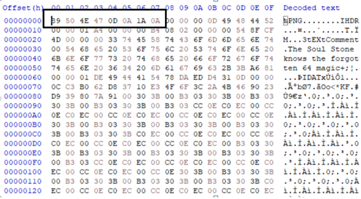

# The Soul Stone: A Worthy Sacrifice (Stego-Crypto, Medium)

**Author:** Krishna Kulkarni  
**Category:** Crypto  
**Difficulty:** Medium

## Challenge Description

> “A soul for a soul. Nothing of value is ever gained without sacrifice.”

On Vormir, the Soul Stone remembers every sacrifice made in its name. Two artifacts have been recovered: `soul.enc` and `VORMIR.png`. The first artifact appears to reveal a flag, but not everything is as it seems. The second artifact holds another clue, waiting to be uncovered.

Investigate the files, interpret the hints, and uncover the flag hidden within the sacrifice.

---

## Step 1 — Investigating `soul.enc`

We begin by examining `soul.enc`. The file contains the following encoded string:

```text
GRgTHhkpAgcXEhodAwMNHwwfEwIQCBsBCRwTDhsbEAYRCDQ=
```

The string resembles Base64. Decoding it produces binary data rather than readable text. Further analysis using the key `VORMIR` reveals the following flag-like string:

```text
OWASP{THE_SOUL_REMEMBERS_SACRIFICE}
```

However, this is only a decoy. The first artifact is not the final answer.

## Step 2 — Hint 1: The First Sacrifice

> “The first offering may deceive you. To move forward, you must turn your back on what you see.”

The hint suggests that the first result is misleading. Instead of accepting the apparent flag, we reconsider the data and continue investigating the second artifact.

The phrase “turn your back” also suggests that reversing something may be important.

## Step 3 — Examining `VORMIR.png`

We inspect the second artifact to identify its file format and search for hidden clues.

The file begins with these PNG magic bytes:

```text
89 50 4E 47 0D 0A 1A 0A
```

These bytes identify the file as a PNG image. Their Base64 representation is:

```text
iVBORw0KGgo=
```

The image also contains a metadata comment:

```text
The Soul Stone knows the forgotten 64 magic
```

This clue points toward Base64 and encourages us to examine the file's underlying data rather than relying only on its visual appearance.



## Step 4 — Hint 2: Turn Back Time

> “The path forward may be found by looking backward. Sometimes, the answer reveals itself only when the order is reversed.”

This hint reinforces the reversal idea introduced by the first hint. We now consider whether the relevant encoded string or data must be reversed before continuing the analysis.

Reversing the Base64 representation of the PNG signature,

```text
iVBORw0KGgo=
```

produces:

```text
=ogKGwRBO VBi
```

Without the space:

```text
=ogKGwRBOVBi
```

This is a character reversal, not a valid standard Base64 payload as written. Therefore, it is a clue to investigate further—not the final flag itself. The exact data intended to be reversed must be confirmed through further analysis.

## Step 5 — Putting the Clues Together

The challenge combines several techniques and observations:

1. **Encoded data:** Inspect and decode the content of `soul.enc`.
2. **Decoy flag:** Recognize that the first flag-like result is misleading.
3. **File identification:** Use PNG magic bytes to identify the second artifact.
4. **Base64:** Investigate the “forgotten 64 magic” clue.
5. **Reversal:** Determine which relevant data needs to be read backward.

Together, the hints encourage us to question the first result, inspect the second artifact, and investigate the relationship between reversal and Base64.

## Final Flag

```text
OWASP{=ogKGwRBOVBi}
```

## Conclusion

The Soul Stone challenge demonstrates the importance of examining files carefully rather than trusting the first apparent result. By analyzing encoded content, inspecting file signatures and metadata, and interpreting the hints, we can follow the intended path toward the hidden flag.