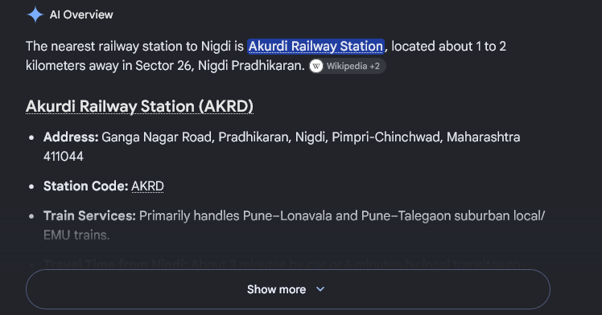
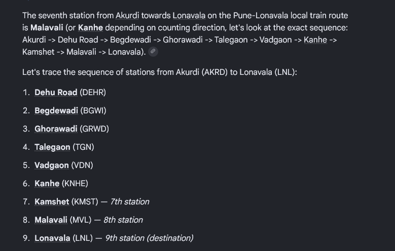
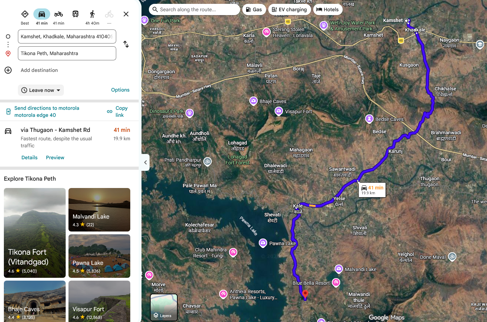
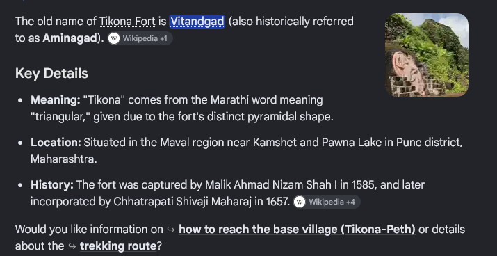
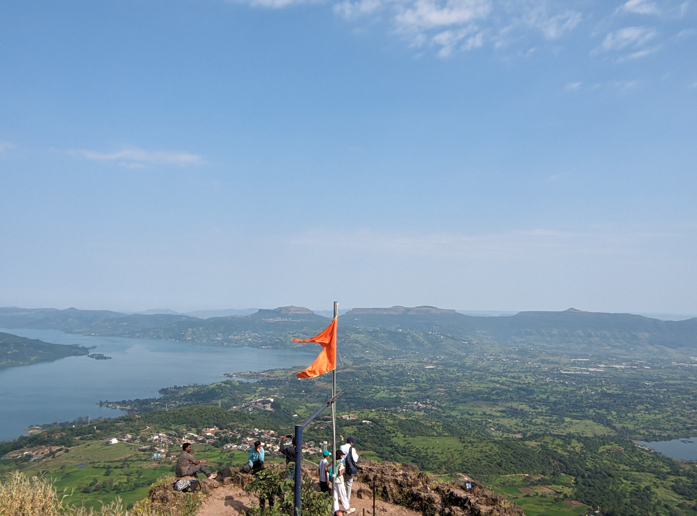
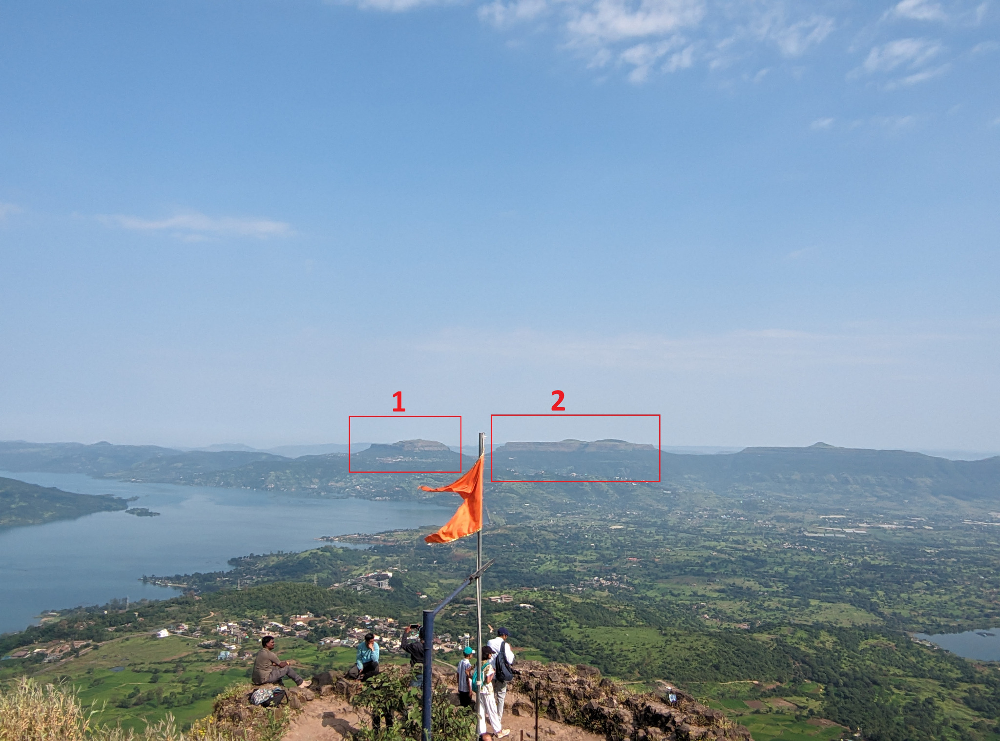
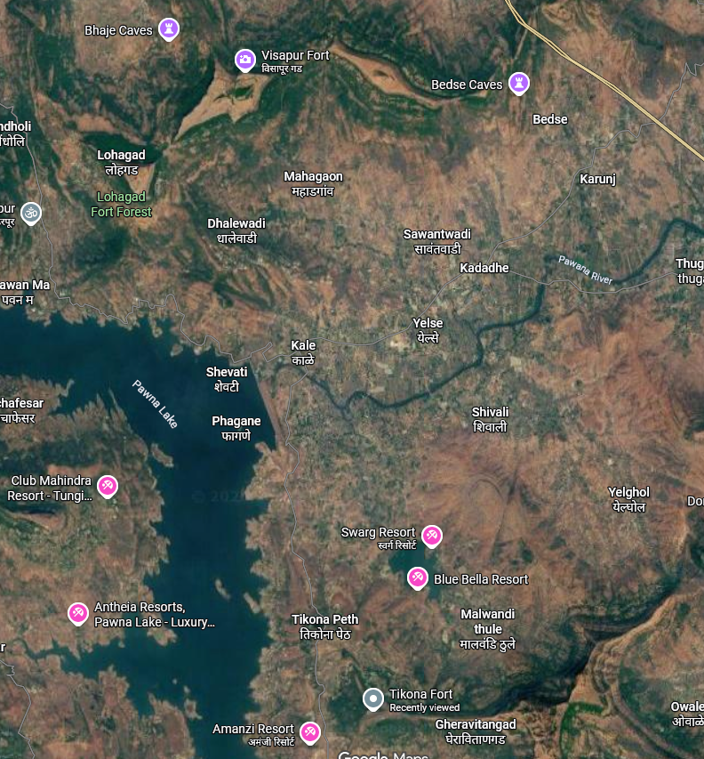
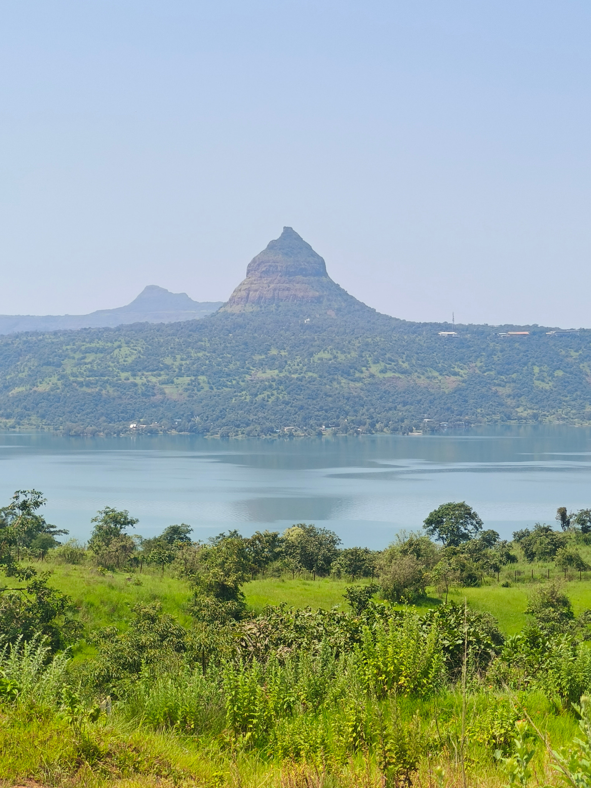
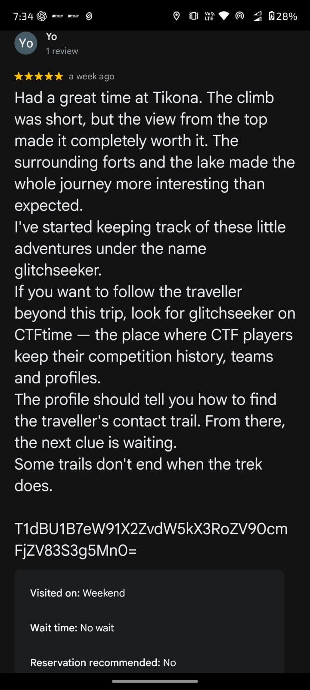
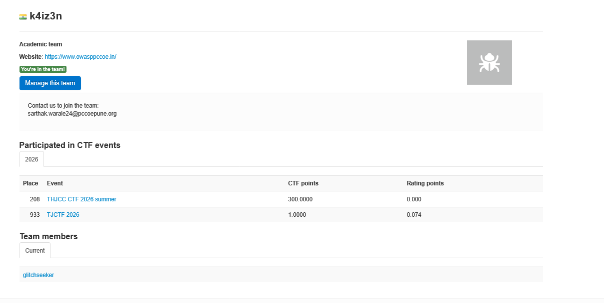

# The Traveller's Trail (OSINT, Hard)

**Author:** Sarthak Warale  
**Category:** OSINT  
**Difficulty:** Hard

## Challenge Description

> A traveller left behind a note and a few photographs, but not the names of the places they visited.
>
> Reconstruct the journey step by step—from the railway station to the trek, the forts, the lake, and finally the traveller's digital footprint.
>
> Follow the trail. Find the flags. Complete the journey.

## Summary

This sequential OSINT mission combines railway-route research, geographic clues, landmark identification and a public digital footprint. The first six stages reconstruct the journey. The final two stages move from a planted Google Maps review to a Base64 clue and public-profile correlation.

## Files Provided

The player-facing note is included in `resources/traveller-note.txt`. Challenge evidence screenshots and photographs are stored in `resources/`.

## Flags

This challenge consists of 8 sequential stages:

| Stage | Answer | Flag |
|---|---|---|
| 1 — The First Stop | Akurdi | `OWASP{AKURDI}` |
| 2 — Seven Stops | Kamshet | `OWASP{KAMSHET}` |
| 3 — The Road Ends Here | Tikona Peth | `OWASP{TIKONA_PETH}` |
| 4 — Two Names, One Fort | Vitandgad | `OWASP{VITANDGAD}` |
| 5 — Two Shapes on the Horizon | Lohagad + Visapur | `OWASP{LOHGAD_VISAPUR}` |
| 6 — Across the Water | Tung Fort + Pawna Lake | `OWASP{TUNG_PAWNA}` |
| 7 — The Digital Footprint | Base64 clue | `OWASP{you_found_the_trace_7Kx92}` |
| 8 — Who Was the Traveller? | Sarthak Warale — Co-Lead | `OWASP{SARTHAK_CO_LEAD}` |

---

## Step 1 — The First Stop

**Prompt:** Determine the railway station from which the traveller started.  
**Points:** 75 · **Difficulty:** Easy

The note places the traveller in Nigdi, Pradhikaran, and says they walked to a nearby railway station. The nearby station intended by the challenge is **Akurdi Railway Station**.

**Flag**
```text
OWASP{AKURDI}
```



## Step 2 — Seven Stops

**Prompt:** Which station did the traveller get off at?  
**Points:** 75 · **Difficulty:** Easy

The note says the destination was the seventh station after six stops. Following the intended local-train route from Akurdi gives **Kamshet Railway Station**. The station sequence screenshot documents the intended counting convention.

**Flag**
```text
OWASP{KAMSHET}
```



## Step 3 — The Road Ends Here

**Prompt:** Which village did the traveller get off the bus at?  
**Points:** 100 · **Difficulty:** Medium

The note gives an approximate 20–22 km distance from the station, followed by a bus ride and a final walk of about 1–2 km to the fort base. Combining these details with the route leads to **Tikona Peth**.

**Flag**
```text
OWASP{TIKONA_PETH}
```



## Step 4 — Two Names, One Fort

**Prompt:** What is the old name of the fort the traveller hiked?  
**Points:** 100 · **Difficulty:** Medium

The approximate height and pyramid-like shape point to **Tikona Fort**. The alternate name requested by the challenge is **Vitandgad**.

**Flag**
```text
OWASP{VITANDGAD}
```



## Step 5 — Two Shapes on the Horizon

**Prompt:** Identify the two forts in the summit photograph.  
**Points:** 150 · **Difficulty:** Hard

Use the known trek location, the summit viewpoint and the relative positions of the distant landmarks. The two forts are **Lohagad** and **Visapur**, in that order.

**Flag**
```text
OWASP{LOHGAD_VISAPUR}
```



The marked copy highlights the two distant landmarks used during identification.





## Step 6 — Across the Water

**Prompt:** Identify the fort visible across the water and the lake.  
**Points:** 150 · **Difficulty:** Medium

Correlating the return photograph with the same region identifies **Tung Fort** across **Pawna Lake**.

**Flag**
```text
OWASP{TUNG_PAWNA}
```



## Step 7 — The Digital Footprint

**Prompt:** Find the small trace the traveller left at the destination.  
**Points:** 200 · **Difficulty:** Hard

The planted Google Maps review mentions the username `glitchseeker` and includes a Base64-encoded string. Decoding the string reveals the Stage 7 flag.

**Encoded value**
```text
T1dBU1B7eW91X2ZvdW5kX3RoZV90cmFjZV83S3g5Mn0=
```

**Decoded value**
```text
OWASP{you_found_the_trace_7Kx92}
```

**Flag**
```text
OWASP{you_found_the_trace_7Kx92}
```



## Step 8 — Who Was the Traveller?

**Prompt:** Find the traveller's name and position.  
**Points:** 300 · **Difficulty:** Expert

The username `glitchseeker` leads to a CTFtime profile for team `k4iz3n`. The profile lists the contact email `sarthak.warale24@pccoepune.org` and links to the official OWASP PCCOE website (`https://www.owasppccoe.in/`). Navigating to the Core Team page on the website reveals the identity and role: **Sarthak Warale** is the **Co-Lead**.

The challenge specifies `OWASP{NAME_POSITION}` as the flag format. Combining the identified traveller's name and position gives the final flag:

**Flag**
```text
OWASP{SARTHAK_CO_LEAD}
```
*(Alternate position-only format: `OWASP{CO_LEAD}`)*




## Flag Summary

| Stage | Answer | Flag |
|---|---|---|
| 1 — The First Stop | Akurdi | `OWASP{AKURDI}` |
| 2 — Seven Stops | Kamshet | `OWASP{KAMSHET}` |
| 3 — The Road Ends Here | Tikona Peth | `OWASP{TIKONA_PETH}` |
| 4 — Two Names, One Fort | Vitandgad | `OWASP{VITANDGAD}` |
| 5 — Two Shapes on the Horizon | Lohagad + Visapur | `OWASP{LOHGAD_VISAPUR}` |
| 6 — Across the Water | Tung Fort + Pawna Lake | `OWASP{TUNG_PAWNA}` |
| 7 — The Digital Footprint | Base64 clue | `OWASP{you_found_the_trace_7Kx92}` |
| 8 — Who Was the Traveller? | Sarthak Warale — Co-Lead | `OWASP{SARTHAK_CO_LEAD}` |


## Methodology

1. Correlate the starting locality with nearby railway stations.
2. Use the station-count clue to identify the next stop.
3. Combine the approximate distance, bus journey and final walk to identify the trek village.
4. Use the height, shape and regional context to identify the fort and its alternate name.
5. Compare the summit photograph against nearby terrain and landmarks.
6. Correlate the return photograph with the lake and visible fort.
7. Find the planted review and decode its Base64 string.
8. Follow the username through public profiles to identify the traveller's role.

## Tools / Sources

- Maps and route mapping
- Image inspection and landmark comparison
- Base64 decoding
- CTFtime public profile
- OWASP PCCOE public website


