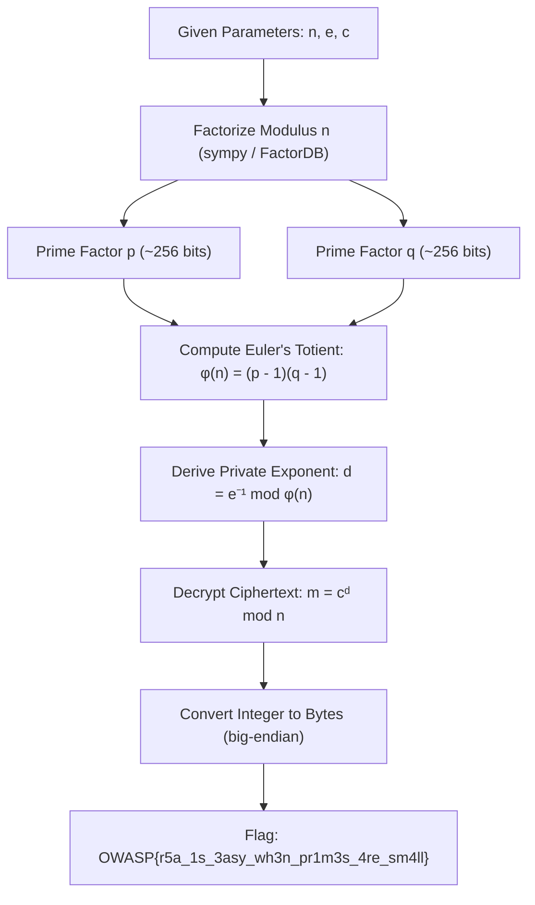

# Soul's Locked Message (Cryptography, Easy)

**Author:** Suyog Jadhav  
**Category:** Cryptography  
**Difficulty:** Easy  

## Challenge Description

> Thanos encrypted a secret message using RSA.  
>  
> He believed the two primes protecting the Soul Stone were impossible to recover.  
>  
> Unfortunately for him, the primes were... not exactly large.  
>  
> Can you recover the message?  
>  
> **Flag Format:** `OWASP{...}`

### Given Parameters
```text
=== Soul's Locked Message ===
n = 6449532267779447351663897013188090145564263455587622461927118526627616204482433356040522957273837936749400700891863976105743563635576474167612348778693883
e = 65537
c = 2158566680867780440751710410606396264856347294813562081688332544610378951560972509642880335284414600125431031093545016412459984599106647039686416700181597
```

## Summary

The challenge implements an RSA cryptosystem with an undersized 512-bit modulus $n$ generated from two 256-bit prime numbers $p$ and $q$. Because 512-bit moduli offer negligible cryptographic security against modern factorization algorithms, $n$ can be quickly decomposed into its prime factors using automated factorization tools or integer factorization libraries (`sympy.factorint`, FactorDB, or Pollard's algorithms). With $p$ and $q$ recovered, we calculate Euler's totient $\phi(n) = (p-1)(q-1)$, compute the modular inverse private exponent $d \equiv e^{-1} \pmod{\phi(n)}$, and decrypt the ciphertext $m \equiv c^d \pmod{n}$ to recover the flag.

## Flag

```
OWASP{r5a_1s_3asy_wh3n_pr1m3s_4re_sm4ll}
```

---

## Step 1 — Analyze the RSA Parameters

We are provided with the public key parameters $(n, e)$ and the ciphertext $c$:

- **Public Exponent ($e$):** `65537` ($2^{16} + 1$, the standard Fermat prime $F_4$)
- **Modulus ($n$):** 155 decimal digits
- **Ciphertext ($c$):** 154 decimal digits

Checking the bit-length of the modulus $n$:

$$\lfloor\log_2(n)\rfloor + 1 = 511 \text{ bits}$$

In production cryptographic deployments, secure RSA keys require at least 2048 to 4096 bits. A 512-bit modulus is small enough to factor easily on commodity hardware, making the challenge susceptible to direct factorization.

---

## Step 2 — Factorize Modulus $n$ into Primes $p$ and $q$

The security of standard textbook RSA relies entirely on the hardness of the **Integer Factorization Problem**: finding prime factors $p$ and $q$ such that:

$$n = p \times q$$

Since $p$ and $q$ were chosen as small 256-bit primes, we can factor $n$ directly using Python's `sympy.factorint` or automated online factorization databases like FactorDB:

```python
from sympy import factorint

n = 6449532267779447351663897013188090145564263455587622461927118526627616204482433356040522957273837936749400700891863976105743563635576474167612348778693883
factors = factorint(n)
p, q = list(factors.keys())
```

Once $n$ is split into its constituent primes $p$ and $q$, the secrecy of the private key is broken.

---

## Step 3 — Compute Euler's Totient $\phi(n)$ & Private Exponent $d$

With $p$ and $q$ known, we compute Euler's totient function $\phi(n)$:

$$\phi(n) = (p - 1)(q - 1)$$

The private decryption exponent $d$ is the modular multiplicative inverse of $e$ modulo $\phi(n)$:

$$d \equiv e^{-1} \pmod{\phi(n)}$$

Using Python 3.8+ built-in modular inverse support:

```python
phi = (p - 1) * (q - 1)
d = pow(e, -1, phi)
```

---

## Step 4 — Decrypt the Ciphertext

RSA decryption is performed by computing:

$$m \equiv c^d \pmod{n}$$

Finally, the recovered integer $m$ is converted from a big-endian integer into ASCII bytes:

```python
m = pow(c, d, n)
flag = m.to_bytes((m.bit_length() + 7) // 8, byteorder="big").decode()
print("Flag:", flag)
```

Output:
```
Flag: OWASP{r5a_1s_3asy_wh3n_pr1m3s_4re_sm4ll}
```

---

## Full Solve Script

The complete Python automated solver [`solve.py`](file:///home/suyog/Documents/writeups/Writeups/suyog/CRYPTO/solve.py):

```python
#!/usr/bin/env python3
from sympy import factorint

n = 6449532267779447351663897013188090145564263455587622461927118526627616204482433356040522957273837936749400700891863976105743563635576474167612348778693883
e = 65537
c = 2158566680867780440751710410606396264856347294813562081688332544610378951560972509642880335284414600125431031093545016412459984599106647039686416700181597

# 1. Factor n into p and q
factors = factorint(n)
p, q = list(factors.keys())

# 2. Compute Euler's totient
phi = (p - 1) * (q - 1)

# 3. Compute private decryption key d
d = pow(e, -1, phi)

# 4. Decrypt ciphertext m = c^d mod n
m = pow(c, d, n)

# 5. Decode integer to ASCII string
flag = m.to_bytes((m.bit_length() + 7) // 8, byteorder="big").decode()
print("Recovered Flag:", flag)
```

---

## Attack Workflow



---

## Solution Summary

| Field | Value |
|---|---|
| **Challenge** | Soul's Locked Message |
| **Category** | Cryptography (Asymmetric / RSA) |
| **Difficulty** | Easy |
| **Key Size** | 511 bits (~512-bit RSA) |
| **Prime Sizes** | $p \approx 256$ bits, $q \approx 256$ bits |
| **Core Vulnerability** | Insufficient Modulus Size / Weak Prime Generation |
| **Flag** | `OWASP{r5a_1s_3asy_wh3n_pr1m3s_4re_sm4ll}` |

---

## Cryptographic Vulnerability Explanation

1. **Why 512-bit RSA is Insecure:**  
   The General Number Field Sieve (GNFS) algorithm can factor 512-bit composite numbers in minimal time. The first public 512-bit RSA factorization (RSA-155) occurred as early as August 1999. Today, 512-bit numbers can be factored in hours or minutes on consumer-grade computers.
2. **Proper Prime Generation in Modern Standards:**  
   Industry guidelines (NIST SP 800-57, BSI) mandate a minimum key length of 2048 bits for RSA, with each prime ($p$ and $q$) chosen independently and uniformly at random with at least 1024 bits.
3. **Euler's Totient Exposure:**  
   Knowledge of $p$ and $q$ directly allows immediate calculation of $\phi(n)$. Once $\phi(n)$ is known, computing $d = e^{-1} \pmod{\phi(n)}$ requires only the Extended Euclidean Algorithm, reducing the decryption effort to trivial arithmetic.

---

## Tools Used

- **Python 3:** Scripting environment for mathematical operations and type conversions.
- **`sympy`:** Symbolic mathematics library used for prime factorization (`sympy.factorint`).
- **Core Arithmetic:** Python 3.8+ modular inverse operator `pow(e, -1, phi)`.

---

## Timeline

| Step | Action | Result |
|:---:|---|---|
| 1 | Inspected provided parameters $(n, e, c)$ | Found $n$ has a weak key length of only 511 bits |
| 2 | Factored $n$ using `sympy.factorint` | Decomposed $n$ into 256-bit primes $p$ and $q$ |
| 3 | Calculated Euler's totient $\phi(n)$ | $\phi(n) = (p-1)(q-1)$ |
| 4 | Computed private exponent $d$ | Inverted public exponent $e$ modulo $\phi(n)$ |
| 5 | Decrypted ciphertext $c$ | Recovered integer plaintext $m \equiv c^d \pmod{n}$ |
| 6 | Decoded plaintext integer | Extracted `OWASP{r5a_1s_3asy_wh3n_pr1m3s_4re_sm4ll}` |