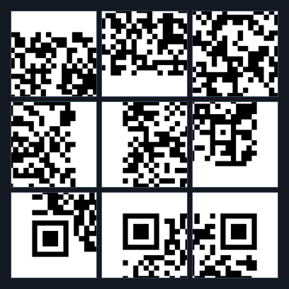
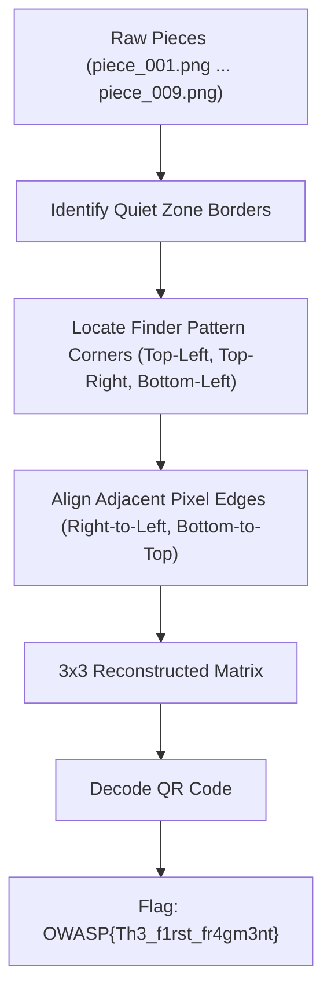

# Level 0 — First Fragment (Misc, Easy)

**Author:** Suyog Jadhav  
**Category:** Misc / Steganography  
**Difficulty:** Easy  
**Flag:** `OWASP{Th3_f1rst_fr4gm3nt}`  

---

## 1. Challenge Description

> The Soul Stone has shattered, and the first fragment lies hidden among nine pieces. Reassemble the fragments to recover the first trace of the Stone’s power.

The challenge provides an archive of image fragments (`pieces_0.zip`) containing 9 separate square image tiles. The objective is to assemble the fragments into the complete original image and extract the flag.

---

## 2. Summary

Level 0 is the foundational stage of the Soul Stone QR mission series:
* **Grid Dimension:** $3 \times 3$ grid (9 pieces total).
* **Transformations:** None (0° rotation, no horizontal or vertical reflections).
* **Decoys:** None (all 9 pieces are genuine parts of the original image).
* **Solution Method:** Visual edge alignment or boundary pixel matching to reconstruct the QR code, followed by QR code scanning.

---

## 3. Flag

```text
OWASP{Th3_f1rst_fr4gm3nt}
```

---

## 4. Step-by-Step Breakdown

### Step 1: Fragment Reconnaissance & Inspection

Unpacking the challenge archive reveals 9 distinct image fragments named `piece_001.png` through `piece_009.png`:

```bash
unzip pieces_0.zip -d pieces_0/
file pieces_0/*.png
```

Each piece is a square PNG tile of identical dimensions ($84 \times 84$ pixels), rendered in grayscale/binary black and white:



Inspecting the fragments reveals distinctive QR code structural elements:
1. **Finder Patterns:** Three pieces contain recognizable nested square concentric rings ($7 \times 7$ modules) located at the top-left, top-right, and bottom-left positions of standard QR codes.
2. **Quiet Zone:** Outer border pieces feature solid white margin padding along their exterior boundaries.

---

### Step 2: Edge Matching & Assembly Logic

Since rotations and reflections are disabled in Level 0, each piece preserves its original orientation. Reconstruction simply requires finding the correct permutation of pieces in a $3 \times 3$ matrix:



To automate the assembly, adjacent horizontal and vertical pixel vectors are compared using Mean Squared Error (MSE):

$$\text{MSE}(A_{\text{right}}, B_{\text{left}}) = \frac{1}{H} \sum_{y=0}^{H-1} (A[y, W-1] - B[y, 0])^2$$

Because no noise or blurring is applied, exact matches yield an MSE of `0.0`.

---

### Step 3: Reconstructing and Scanning the QR Code

Using the boundary constraints and edge compatibility, the pieces are stitched onto a $252 \times 252$ pixel canvas:

```python
from PIL import Image

# Final piece placement mapping for 3x3 grid
grid = [
    ["piece_003.png", "piece_007.png", "piece_001.png"],
    ["piece_009.png", "piece_004.png", "piece_006.png"],
    ["piece_002.png", "piece_008.png", "piece_005.png"]
]

canvas = Image.new("L", (252, 252), 255)
tile_size = 84

for r, row in enumerate(grid):
    for c, name in enumerate(row):
        tile = Image.open(f"pieces_0/{name}")
        canvas.paste(tile, (c * tile_size, r * tile_size))

canvas.save("reconstructed_level0.png")
```

The resulting assembled QR code:


Scanning the reconstructed image with `zbarimg` reveals the message:

```bash
zbarimg resources/level0_solved_qr.png
```

```text
QR-Code:SOUL STONE // FIRST FRAGMENT // OWASP{Th3_f1rst_fr4gm3nt}
scanned 1 barcode symbols from 1 images in 0.01 seconds
```

---

## 5. Solution Summary

| Parameter | Specification |
|---|---|
| **Grid Size** | $3 \times 3$ (9 tiles) |
| **Tile Resolution** | $84 \times 84$ px |
| **Transformations** | None (Original orientation) |
| **Decoy Tiles** | 0 |
| **Decoded String** | `SOUL STONE // FIRST FRAGMENT // OWASP{Th3_f1rst_fr4gm3nt}` |
| **Flag** | `OWASP{Th3_f1rst_fr4gm3nt}` |

---

## 6. Methodology & Key Concepts

1. **QR Finder Pattern Geometry:** A QR code always places $7 \times 7$ module finder markers at three fixed locations: Top-Left `(0, 0)`, Top-Right `(0, N-1)`, and Bottom-Left `(N-1, 0)`. In a $3 \times 3$ fragment grid, these uniquely identify three corners immediately.
2. **Deterministic Edge Continuity:** Adjacent image tiles must share continuous module lines across boundaries, enabling quick manual or algorithmic verification.

---

## 7. Tools Used

* **Image Processing:** Python (PIL / Pillow, OpenCV)
* **Barcode Decoders:** `zbarimg` / `pyzbar`
* **File Utilities:** `unzip`, `file`

---

## 8. Timeline

| Time / Stage | Action Taken | Result |
|---|---|---|
| 00:00 - 00:01 | Unpacked `pieces_0.zip` and inspected 9 PNG tiles | Identified 3 finder pattern tiles and quiet-zone borders |
| 00:01 - 00:02 | Mapped tiles to $3 \times 3$ grid using corner anchors | Assembled contiguous QR image |
| 00:02 - 00:03 | Decoded QR code using `zbarimg` | Recovered `OWASP{Th3_f1rst_fr4gm3nt}` |
