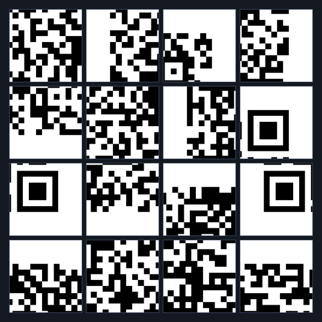
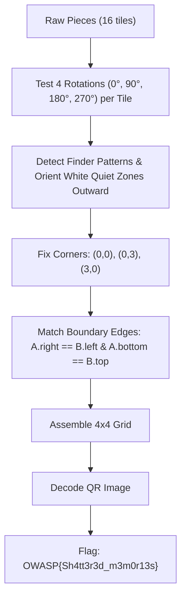

# Level 1 — Shattered Memories (Misc, Easy)

**Author:** Suyog Jadhav  
**Category:** Misc / Steganography  
**Difficulty:** Easy  
**Flag:** `OWASP{Sh4tt3r3d_m3m0r13s}`  

---

## 1. Challenge Description

> The fragments carry memories distorted by the collapse of Vormir. Sixteen pieces remain, but each has been twisted from its original orientation. Restore the memories and reveal what the Stone is trying to tell you.

The challenge provides an archive of image fragments (`pieces_1.zip`) containing 16 separate square image tiles. Unlike Level 0, each piece has been randomly rotated by a multiple of 90 degrees ($0^\circ, 90^\circ, 180^\circ, 270^\circ$).

---

## 2. Summary

Level 1 escalates complexity by introducing rotational transformation:
* **Grid Dimension:** $4 \times 4$ grid (16 pieces total).
* **Transformations:** Random 90-degree rotations ($0^\circ, 90^\circ, 180^\circ, 270^\circ$). No horizontal or vertical reflections.
* **Decoys:** None (all 16 pieces belong to the final image).
* **Solution Method:** Evaluate each piece across 4 rotational angles, reconstruct the finder patterns with correct orientations, align edges across adjacent boundaries, and scan the assembled QR code.

---

## 3. Flag

```text
OWASP{Sh4tt3r3d_m3m0r13s}
```

---

## 4. Step-by-Step Breakdown

### Step 1: Fragment Reconnaissance & Rotational Inspection

Extracting `pieces_1.zip` yields 16 PNG images:

```bash
unzip pieces_1.zip -d pieces_1/
ls -l pieces_1/
```

Visualizing the tiles reveals that finder pattern fragments and edge boundary lines are oriented in random directions:



Because a standard QR code has a solid white quiet zone surrounding the perimeter, any piece with a continuous white edge must belong to an outer border, and its white edge must be oriented outward.

---

### Step 2: Resolving Piece Orientations & Finder Pattern Anchors

In a QR code:
1. The Top-Left finder pattern must have white borders on its top and left sides.
2. The Top-Right finder pattern must have white borders on its top and right sides.
3. The Bottom-Left finder pattern must have white borders on its bottom and left sides.



To test orientation programmatically, we rotate candidate tiles and calculate boundary pixel differences with neighboring tiles:

```python
from PIL import Image

def get_edges(img):
    # Returns [top, right, bottom, left] pixel tuples
    w, h = img.size
    pixels = img.load()
    top = tuple(pixels[x, 0] for x in range(w))
    bottom = tuple(pixels[x, h - 1] for x in range(w))
    left = tuple(pixels[0, y] for y in range(h))
    right = tuple(pixels[w - 1, y] for y in range(h))
    return top, right, bottom, left

def evaluate_rotations(piece):
    rotations = {}
    for angle in [0, 90, 180, 270]:
        # PIL rotate is counter-clockwise; generator applied clockwise
        rotated = piece.rotate((-angle) % 360)
        rotations[angle] = (rotated, get_edges(rotated))
    return rotations
```

---

### Step 3: Reconstructing and Scanning the QR Code

Once all 16 pieces are placed in their respective $(r, c)$ slots with corrected rotation angles:

```python
# Reconstruct onto 4x4 grid
grid_n = 4
tile_size = 63  # Tile dimensions
canvas = Image.new("L", (grid_n * tile_size, grid_n * tile_size), 255)

# After solving placement and angles
for item in solution:
    r, c, name, angle = item["row"], item["col"], item["file"], item["angle"]
    piece = Image.open(f"pieces_1/{name}").convert("L")
    piece = piece.rotate((-angle) % 360)
    canvas.paste(piece, (c * tile_size, r * tile_size))

canvas.save("reconstructed_level1.png")
```

The resulting assembled QR code:


Scanning the reconstructed image:

```bash
zbarimg resources/level1_solved_qr.png
```

```text
QR-Code:SOUL STONE // SHATTERED MEMORIES // OWASP{Sh4tt3r3d_m3m0r13s}
scanned 1 barcode symbols from 1 images in 0.01 seconds
```

---

## 5. Solution Summary

| Parameter | Specification |
|---|---|
| **Grid Size** | $4 \times 4$ (16 tiles) |
| **Tile Resolution** | $63 \times 63$ px |
| **Transformations** | Random Rotations ($0^\circ, 90^\circ, 180^\circ, 270^\circ$) |
| **Decoy Tiles** | 0 |
| **Decoded String** | `SOUL STONE // SHATTERED MEMORIES // OWASP{Sh4tt3r3d_m3m0r13s}` |
| **Flag** | `OWASP{Sh4tt3r3d_m3m0r13s}` |

---

## 6. Methodology & Key Concepts

1. **Rotational Invariance via Edge Matching:** A piece has 4 rotational states. When matching tile $A$ horizontally adjacent to tile $B$, we search over all 16 $(rot_A, rot_B)$ angle pairs for edge compatibility ($A_{\text{right}} = B_{\text{left}}$).
2. **Quiet Zone Edge Anchoring:** Any edge that is completely white (intensity 255) must be on the image boundary, eliminating 3 out of 4 possible orientations for border tiles immediately.

---

## 7. Tools Used

* **Image Processing:** Python (PIL / Pillow, NumPy, OpenCV)
* **Barcode Decoders:** `zbarimg` / OpenCV `QRCodeDetector`
* **File Utilities:** `unzip`

---

## 8. Timeline

| Time / Stage | Action Taken | Result |
|---|---|---|
| 00:00 - 00:01 | Extracted 16 pieces from `pieces_1.zip` | Discovered $90^\circ$ rotational distortion |
| 00:01 - 00:03 | Filtered quiet-zone edges to orient boundary tiles | Corner and border orientations resolved |
| 00:03 - 00:04 | Solved interior tile rotations using edge-continuity | Complete $4 \times 4$ QR code reconstructed |
| 00:04 - 00:05 | Decoded output using `zbarimg` | Recovered `OWASP{Sh4tt3r3d_m3m0r13s}` |
