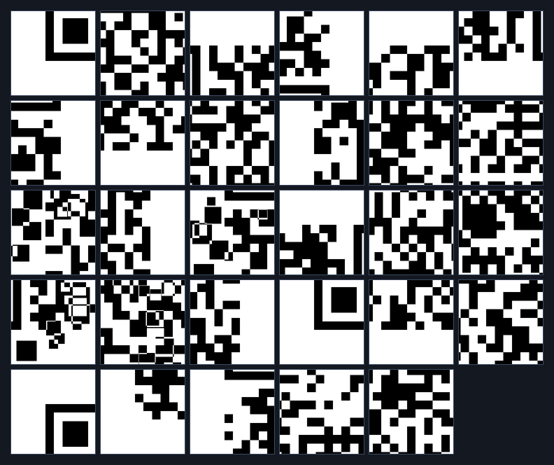
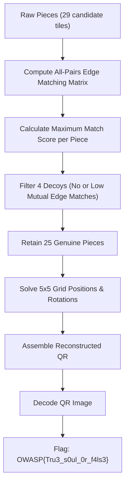

# Level 2 — False Souls (Misc, Medium)

**Author:** Suyog Jadhav  
**Category:** Misc / Steganography  
**Difficulty:** Medium  
**Flag:** `OWASP{Tru3_s0ul_0r_f4ls3}`  

---

## 1. Challenge Description

> Not every fragment belongs to the Soul Stone. Among the scattered remains, false souls have been mixed with the genuine pieces. Identify the four impostors and reconstruct the true message before the deception consumes the trail.

The challenge provides an archive of image fragments (`pieces_2.zip`) containing 29 square image tiles. However, the final QR code requires a $5 \times 5$ grid (25 tiles). Exactly 4 pieces are decoys that do not belong to the original QR code. Furthermore, genuine tiles have been randomly rotated.

---

## 2. Summary

Level 2 introduces the decoy mechanic alongside rotational distortion:
* **Grid Dimension:** $5 \times 5$ grid (25 valid pieces required).
* **Dataset Size:** 29 total pieces (25 valid + 4 decoys).
* **Transformations:** Random rotations ($0^\circ, 90^\circ, 180^\circ, 270^\circ$).
* **Decoys:** 4 false pieces designed to pollute edge matching and prevent naive assembly.
* **Solution Method:** Build an edge compatibility score matrix across all $(piece_i, piece_j, rot_i, rot_j)$ combinations. Eliminate pieces with near-zero or poor global edge matches, resolve orientations, assemble the $5 \times 5$ grid, and scan the QR code.

---

## 3. Flag

```text
OWASP{Tru3_s0ul_0r_f4ls3}
```

---

## 4. Step-by-Step Breakdown

### Step 1: Fragment Reconnaissance & Decoy Analysis

Unpacking `pieces_2.zip` yields 29 files:

```bash
unzip pieces_2.zip -d pieces_2/
ls -l pieces_2/ | wc -l
```

Visualizing the fragments shows 29 candidate pieces with varied module densities:



Because a $5 \times 5$ QR code has exactly 25 positions, 4 pieces must be discarded. If a piece cannot form valid boundary matches with any other piece in the pool under any rotation, it is guaranteed to be a decoy.

---

### Step 2: Edge Compatibility Matrix & Decoy Pruning

For every piece $i \in [1, 29]$ and every rotation $r_i \in \{0, 90, 180, 270\}$, we extract its four edge pixel vectors: `top`, `bottom`, `left`, `right`.

We define the edge distance between the right edge of tile $A$ and left edge of tile $B$ as:

$$D_{\text{horiz}}(A, B) = \sum_{y=0}^{H-1} |A_{\text{right}}[y] - B_{\text{left}}[y]|$$



Decoys typically fail to match adjacent tiles on multiple sides. By calculating the minimum edge difference for each piece against all other pieces, the 4 decoys stand out with significantly higher mismatch scores:

```python
import numpy as np
from PIL import Image

def find_decoys(pieces, expected_count=25):
    # Compute best edge match count for each piece
    match_counts = {p_id: 0 for p_id in pieces}
    
    for id_a, img_a in pieces.items():
        for id_b, img_b in pieces.items():
            if id_a == id_b:
                continue
            # Check if any rotation of A matches any rotation of B
            if has_compatible_edge(img_a, img_b):
                match_counts[id_a] += 1
                
    # Sort pieces by connectivity
    sorted_pieces = sorted(match_counts.items(), key=lambda x: x[1], reverse=True)
    valid_pieces = [p[0] for p in sorted_pieces[:expected_count]]
    decoys = [p[0] for p in sorted_pieces[expected_count:]]
    return valid_pieces, decoys
```

---

### Step 3: Reconstructing and Scanning the QR Code

Once the 4 decoys are eliminated, the 25 genuine pieces are placed into the $5 \times 5$ canvas:

```python
grid_n = 5
tile_size = 50  # 250x250 total QR resolution
canvas = Image.new("L", (grid_n * tile_size, grid_n * tile_size), 255)

for item in solution:
    r, c, name, angle = item["row"], item["col"], item["file"], item["angle"]
    piece = Image.open(f"pieces_2/{name}").convert("L")
    piece = piece.rotate((-angle) % 360)
    canvas.paste(piece, (c * tile_size, r * tile_size))

canvas.save("reconstructed_level2.png")
```

The resulting assembled QR code:


Scanning the reconstructed image:

```bash
zbarimg resources/level2_solved_qr.png
```

```text
QR-Code:SOUL STONE // FALSE SOULS // OWASP{Tru3_s0ul_0r_f4ls3}
scanned 1 barcode symbols from 1 images in 0.01 seconds
```

---

## 5. Solution Summary

| Parameter | Specification |
|---|---|
| **Grid Size** | $5 \times 5$ (25 tiles) |
| **Tile Resolution** | $50 \times 50$ px |
| **Total Pieces** | 29 (25 Genuine + 4 Decoys) |
| **Transformations** | Random Rotations ($0^\circ, 90^\circ, 180^\circ, 270^\circ$) |
| **Decoys Identified** | 4 non-conforming tiles eliminated |
| **Decoded String** | `SOUL STONE // FALSE SOULS // OWASP{Tru3_s0ul_0r_f4ls3}` |
| **Flag** | `OWASP{Tru3_s0ul_0r_f4ls3}` |

---

## 6. Methodology & Key Concepts

1. **Graph-Based Decoy Pruning:** Genuine puzzle pieces form a connected planar graph where interior nodes have 4 valid edges, border nodes have 3, and corner nodes have 2. Decoys form isolated nodes or single-edge false matches, allowing deterministic pruning.
2. **Degree Centrality:** Calculating the number of zero-error edge neighbors effectively separates genuine QR fragments from artificially injected noise fragments.

---

## 7. Tools Used

* **Image Processing:** Python (PIL / Pillow, NumPy, OpenCV)
* **Barcode Decoders:** `zbarimg` / OpenCV `QRCodeDetector`
* **File Utilities:** `unzip`

---

## 8. Timeline

| Time / Stage | Action Taken | Result |
|---|---|---|
| 00:00 - 00:01 | Inspected `pieces_2/` directory | Counted 29 total tiles for a $5 \times 5$ target |
| 00:01 - 00:03 | Computed pairwise edge compatibility across all 4 rotations | Isolated 4 decoy tiles with low connectivity |
| 00:03 - 00:04 | Solved $5 \times 5$ planar arrangement of 25 genuine tiles | Reconstructed continuous QR code |
| 00:04 - 00:05 | Scanned assembled QR with `zbarimg` | Recovered `OWASP{Tru3_s0ul_0r_f4ls3}` |
