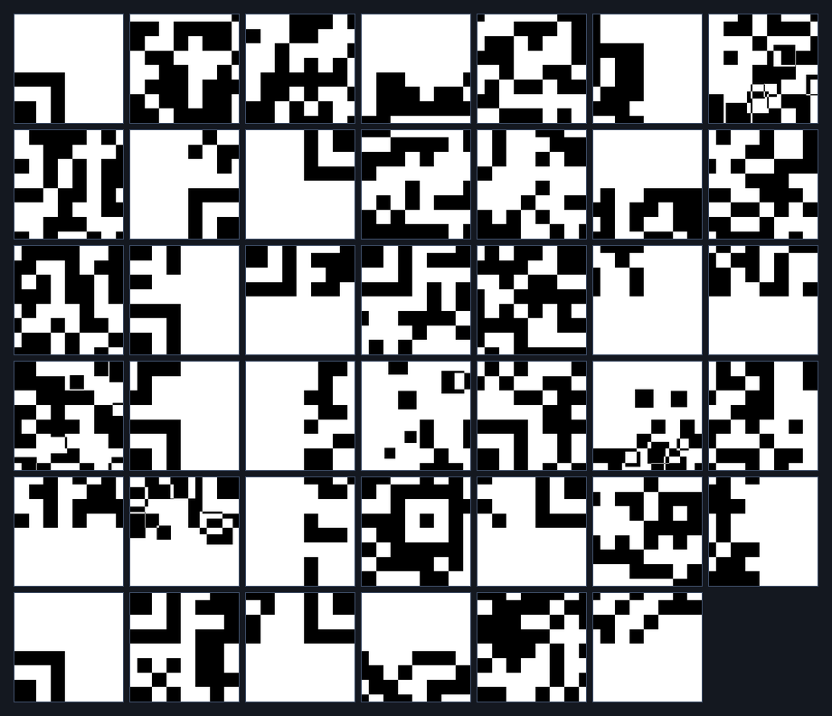
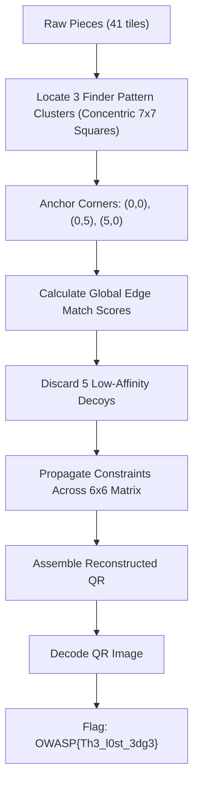

# Level 3 — Lost Edge (Misc, Medium)

**Author:** Suyog Jadhav  
**Category:** Misc / Steganography  
**Difficulty:** Medium  
**Flag:** `OWASP{Th3_l0st_3dg3}`  

---

## 1. Challenge Description

> A portion of the Soul Stone’s edge has vanished into the ruins of Vormir. Forty-one fragments remain, but five are echoes of something that never existed. Separate truth from illusion and restore the lost pattern.

The challenge provides an archive of image fragments (`pieces_3.zip`) containing 41 separate square image tiles. The target QR code corresponds to a $6 \times 6$ grid (36 tiles), meaning 5 pieces are decoy illusions. Furthermore, genuine tiles have been arbitrarily rotated.

---

## 2. Summary

Level 3 increases the puzzle dimensions and decoy counts:
* **Grid Dimension:** $6 \times 6$ grid (36 genuine pieces).
* **Dataset Size:** 41 total pieces (36 valid + 5 decoys).
* **Transformations:** Random rotations ($0^\circ, 90^\circ, 180^\circ, 270^\circ$).
* **Decoys:** 5 false pieces.
* **Solution Method:** Utilize QR finder pattern geometry ($7 \times 7$ modules) to anchor the three corners, apply edge-compatibility filtering to eliminate the 5 decoys, solve tile rotations, assemble the $6 \times 6$ grid, and decode the flag.

---

## 3. Flag

```text
OWASP{Th3_l0st_3dg3}
```

---

## 4. Step-by-Step Breakdown

### Step 1: Fragment Reconnaissance & Inventory

Extracting `pieces_3.zip` produces 41 PNG files:

```bash
unzip pieces_3.zip -d pieces_3/
ls -l pieces_3/*.png | wc -l
```

Previewing the pieces:



At $6 \times 6$, the QR code has 36 valid positions. With 41 pieces provided, 5 are decoys. Because the grid is larger, brute-forcing all permutations is computationally infeasible ($41! \times 4^{36} \approx 10^{71}$ combinations), requiring structured constraint satisfaction.

---

### Step 2: Locating Finder Patterns & Edge Elimination

Standard QR codes feature three prominent finder patterns:
* **Top-Left (TL):** Position `(0, 0)`
* **Top-Right (TR):** Position `(0, 5)`
* **Bottom-Left (BL):** Position `(5, 0)`

Each finder pattern is composed of concentric squares with a $1:1:3:1:1$ black/white ratio:



Pieces containing parts of finder patterns are readily identified through template matching or edge-density statistics. Once the three corners are locked in place, boundary tiles are propagated outward along the perimeter.

Tiles that cannot form valid edges with any adjacent row/column candidates are flagged and removed as decoys:

```python
def filter_decoys(pieces, grid_size=6):
    total_needed = grid_size * grid_size  # 36
    compatibility_scores = {}
    
    for name_a, img_a in pieces.items():
        score = 0
        for name_b, img_b in pieces.items():
            if name_a == name_b:
                continue
            if min_edge_difference(img_a, img_b) == 0:
                score += 1
        compatibility_scores[name_a] = score
        
    # Top 36 pieces with highest valid edge matches
    valid = sorted(compatibility_scores, key=compatibility_scores.get, reverse=True)[:total_needed]
    decoys = set(pieces.keys()) - set(valid)
    return valid, decoys
```

---

### Step 3: Reconstructing and Scanning the QR Code

After removing the 5 decoys and determining each tile's coordinates and rotation:

```python
grid_n = 6
tile_size = 42
canvas = Image.new("L", (grid_n * tile_size, grid_n * tile_size), 255)

for item in solution:
    r, c, name, angle = item["row"], item["col"], item["file"], item["angle"]
    piece = Image.open(f"pieces_3/{name}").convert("L")
    piece = piece.rotate((-angle) % 360)
    canvas.paste(piece, (c * tile_size, r * tile_size))

canvas.save("reconstructed_level3.png")
```

The resulting assembled QR code:


Scanning the reconstructed image:

```bash
zbarimg resources/level3_solved_qr.png
```

```text
QR-Code:SOUL STONE // LOST EDGE // OWASP{Th3_l0st_3dg3}
scanned 1 barcode symbols from 1 images in 0.01 seconds
```

---

## 5. Solution Summary

| Parameter | Specification |
|---|---|
| **Grid Size** | $6 \times 6$ (36 tiles) |
| **Tile Resolution** | $42 \times 42$ px |
| **Total Pieces** | 41 (36 Genuine + 5 Decoys) |
| **Transformations** | Random Rotations ($0^\circ, 90^\circ, 180^\circ, 270^\circ$) |
| **Decoys Identified** | 5 non-conforming tiles eliminated |
| **Decoded String** | `SOUL STONE // LOST EDGE // OWASP{Th3_l0st_3dg3}` |
| **Flag** | `OWASP{Th3_l0st_3dg3}` |

---

## 6. Methodology & Key Concepts

1. **Corner Anchoring with Finder Patterns:** Identifying and orienting the three finder patterns reduces the search space by fixing the absolute positions and orientations of the three primary corners.
2. **Greedy Edge Propagation:** With corner tiles fixed, neighboring pieces along the quiet-zone edges can be resolved greedily by testing which candidate tile satisfies both the outer quiet-zone constraint and the interior edge match.

---

## 7. Tools Used

* **Image Processing:** Python (PIL / Pillow, NumPy, OpenCV)
* **Barcode Decoders:** `zbarimg` / OpenCV `QRCodeDetector`
* **File Utilities:** `unzip`

---

## 8. Timeline

| Time / Stage | Action Taken | Result |
|---|---|---|
| 00:00 - 00:01 | Inspected `pieces_3/` directory | 41 tiles detected for a $6 \times 6$ target |
| 00:01 - 00:03 | Extracted finder patterns & anchored outer corners | Resolved positions `(0,0)`, `(0,5)`, `(5,0)` |
| 00:03 - 00:05 | Pruned 5 decoys using boundary match matrix | Identified 36 genuine tiles |
| 00:05 - 00:06 | Assembled $6 \times 6$ grid and scanned with `zbarimg` | Recovered `OWASP{Th3_l0st_3dg3}` |
