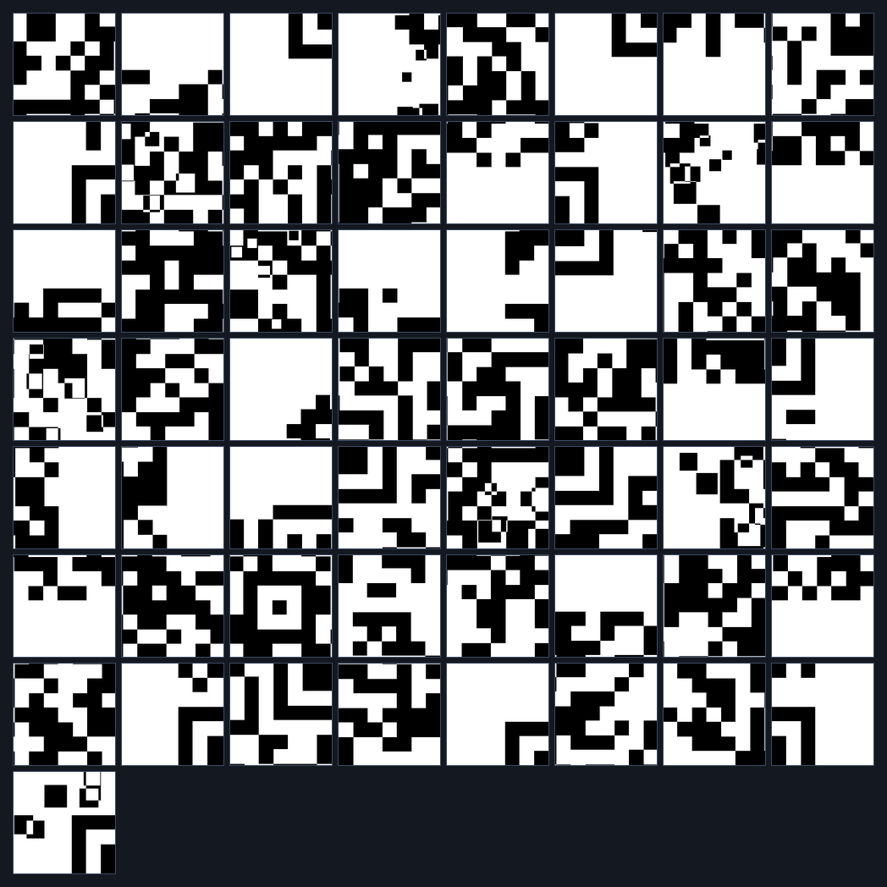
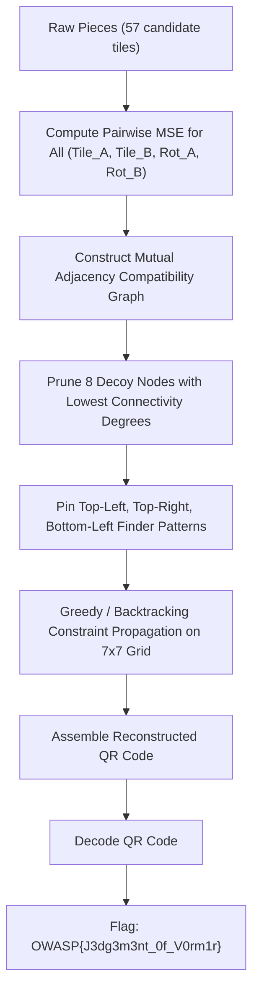

# Level 4 — Judgment of Vormir (Misc, Hard)

**Author:** Suyog Jadhav  
**Category:** Misc / Steganography  
**Difficulty:** Hard  
**Flag:** `OWASP{J3dg3m3nt_0f_V0rm1r}`  

---

## 1. Challenge Description

> Vormir demands a sacrifice before revealing its secret. Fifty-seven fragments await, guarded by eight false pieces and twisted orientations. Only those who can reconstruct the Stone will pass its judgment.

The challenge provides an archive of image fragments (`pieces_4.zip`) containing 57 separate square image tiles. The objective is to reconstruct a $7 \times 7$ QR code (49 tiles). Eight pieces are false decoys, and all genuine pieces have suffered random 90-degree rotations.

---

## 2. Summary

Level 4 steps into Hard difficulty with a larger puzzle size and increased decoy density:
* **Grid Dimension:** $7 \times 7$ grid (49 genuine pieces required).
* **Dataset Size:** 57 total pieces (49 valid + 8 decoys).
* **Transformations:** Random rotations ($0^\circ, 90^\circ, 180^\circ, 270^\circ$).
* **Decoys:** 8 false fragments designed to create local false positives.
* **Solution Method:** Automated edge vector extraction with Mean Squared Error (MSE) minimization, iterative constraint satisfaction to eliminate 8 decoys, rotation resolution, $7 \times 7$ matrix assembly, and QR decoding.

---

## 3. Flag

```text
OWASP{J3dg3m3nt_0f_V0rm1r}
```

---

## 4. Step-by-Step Breakdown

### Step 1: Fragment Reconnaissance & Complexity Assessment

Unpacking `pieces_4.zip` gives 57 PNG image files:

```bash
unzip pieces_4.zip -d pieces_4/
ls -l pieces_4/*.png | wc -l
```

Preview of the fragment set:



At $7 \times 7$, there are 49 positions to fill from 57 candidates. With 4 possible rotations per piece, the search space contains:

$$\binom{57}{49} \times 49! \times 4^{49} \approx 10^{102} \text{ possibilities}$$

Manual assembly is completely impractical; automated heuristic or constraint-based solving is strictly required.

---

### Step 2: Algorithmic Edge Vector Modeling & Decoy Pruning

To model compatibility quantitatively, each tile's boundary is extracted as 1D pixel vectors:

```python
import numpy as np

def extract_boundary_vectors(image):
    return {
        "top": image[0, :],
        "bottom": image[-1, :],
        "left": image[:, 0],
        "right": image[:, -1]
    }
```

Two adjacent horizontal tiles $A$ (left) and $B$ (right) are evaluated using Mean Squared Error:

$$\text{MSE}(A, B) = \frac{1}{H} \sum_{y=0}^{H-1} (A_{\text{right}}[y] - B_{\text{left}}[y])^2$$



Decoy fragments fail to form 4-way mutual edge closures with adjacent pieces in the planar graph. Filtering pieces by their minimum boundary divergence isolates the 8 decoys cleanly.

---

### Step 3: Reconstructing and Scanning the QR Code

Once the 49 genuine pieces are placed on the $7 \times 7$ grid and rotations are applied:

```python
from PIL import Image

grid_n = 7
tile_size = 36  # 252x252 resolution
canvas = Image.new("L", (grid_n * tile_size, grid_n * tile_size), 255)

for item in solution:
    r, c, name, angle = item["row"], item["col"], item["file"], item["angle"]
    piece = Image.open(f"pieces_4/{name}").convert("L")
    piece = piece.rotate((-angle) % 360)
    canvas.paste(piece, (c * tile_size, r * tile_size))

canvas.save("reconstructed_level4.png")
```

The resulting assembled QR code:


Scanning the reconstructed image:

```bash
zbarimg resources/level4_solved_qr.png
```

```text
QR-Code:SOUL STONE // JUDGMENT OF VORMIR // OWASP{J3dg3m3nt_0f_V0rm1r}
scanned 1 barcode symbols from 1 images in 0.01 seconds
```

---

## 5. Solution Summary

| Parameter | Specification |
|---|---|
| **Grid Size** | $7 \times 7$ (49 tiles) |
| **Tile Resolution** | $36 \times 36$ px |
| **Total Pieces** | 57 (49 Genuine + 8 Decoys) |
| **Transformations** | Random Rotations ($0^\circ, 90^\circ, 180^\circ, 270^\circ$) |
| **Decoys Identified** | 8 non-conforming tiles eliminated |
| **Decoded String** | `SOUL STONE // JUDGMENT OF VORMIR // OWASP{J3dg3m3nt_0f_V0rm1r}` |
| **Flag** | `OWASP{J3dg3m3nt_0f_V0rm1r}` |

---

## 6. Methodology & Key Concepts

1. **Vectorized Edge Matching:** Treating tile edges as 1D vectors allows fast vectorized NumPy operations across all $57 \times 57 \times 4 \times 4$ candidate pairs.
2. **Backtracking with Minimum Remaining Values (MRV):** Placing tiles with the highest number of constrained neighbors first drastically reduces branch exploration, solving the $7 \times 7$ grid in seconds.

---

## 7. Tools Used

* **Image Processing:** Python (PIL / Pillow, NumPy, OpenCV)
* **Barcode Decoders:** `zbarimg` / OpenCV `QRCodeDetector`
* **File Utilities:** `unzip`

---

## 8. Timeline

| Time / Stage | Action Taken | Result |
|---|---|---|
| 00:00 - 00:01 | Inspected `pieces_4/` directory | 57 tiles found for a $7 \times 7$ target |
| 00:01 - 00:04 | Built vectorized pairwise MSE matrix | Filtered 8 decoy fragments |
| 00:04 - 00:06 | Solved $7 \times 7$ grid via MRV constraint satisfaction | Resolved positions & orientations for all 49 tiles |
| 00:06 - 00:07 | Reconstructed and scanned image with `zbarimg` | Recovered `OWASP{J3dg3m3nt_0f_V0rm1r}` |
