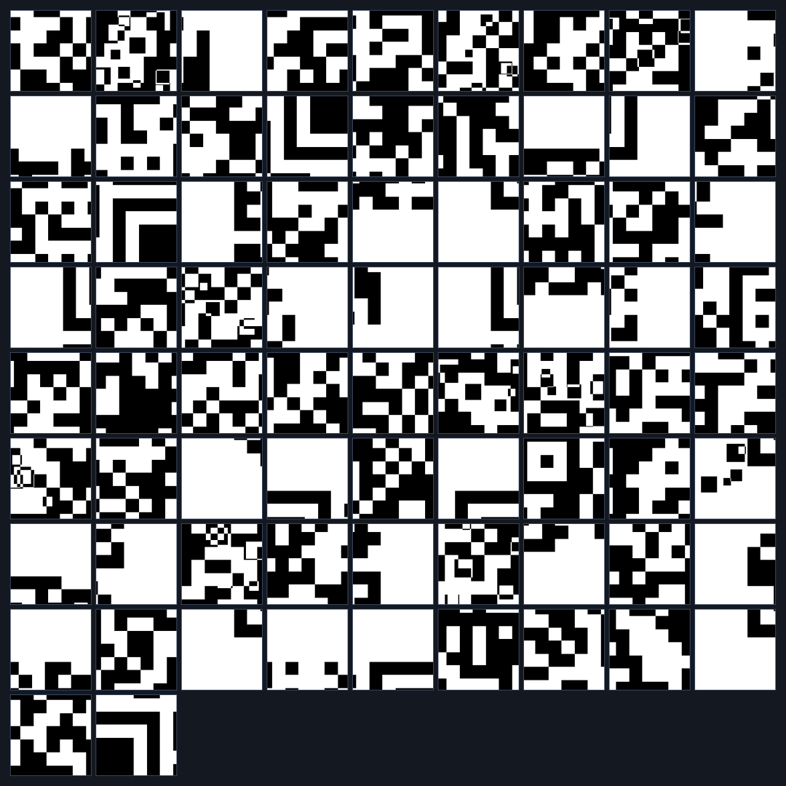
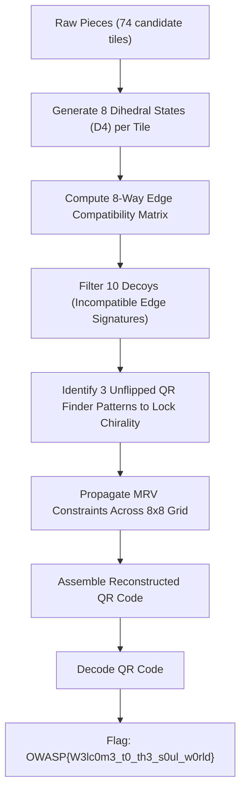

# Level 5 — Soul World (Misc, Hard)

**Author:** Suyog Jadhav  
**Category:** Misc / Steganography  
**Difficulty:** Hard  
**Flag:** `OWASP{W3lc0m3_t0_th3_s0ul_w0rld}`  

---

## 1. Challenge Description

> You have entered the Soul World. Nothing here is what it appears to be. Some fragments have been rotated. Some have been reflected. Others are false memories. Trust nothing. Reconstruct everything.

The challenge provides an archive of image fragments (`pieces_5.zip`) containing 74 square image tiles. The objective is to reconstruct an $8 \times 8$ QR code (64 tiles). In addition to 10 decoy pieces and 90-degree rotations, this level introduces **horizontal and vertical reflections (flips)**, expanding each piece's state space to the 8 symmetries of the Dihedral Group $D_4$.

---

## 2. Summary

Level 5 introduces reflection symmetry transformations:
* **Grid Dimension:** $8 \times 8$ grid (64 genuine pieces required).
* **Dataset Size:** 74 total pieces (64 valid + 10 decoys).
* **Transformations:** Dihedral Group $D_4$ symmetries — 4 rotations ($0^\circ, 90^\circ, 180^\circ, 270^\circ$) combined with horizontal and vertical flips (8 transformation states per piece).
* **Decoys:** 10 false fragments.
* **Solution Method:** Generate all 8 isomorphic transformations per piece, construct a multi-state edge compatibility tensor, prune 10 decoys via degree centrality, locate finder patterns to lock chirality and orientation, assemble the $8 \times 8$ grid, and scan the QR code.

---

## 3. Flag

```text
OWASP{W3lc0m3_t0_th3_s0ul_w0rld}
```

---

## 4. Step-by-Step Breakdown

### Step 1: Fragment Reconnaissance & Symmetry Expansion

Unpacking `pieces_5.zip` yields 74 individual PNG files:

```bash
unzip pieces_5.zip -d pieces_5/
ls -l pieces_5/*.png | wc -l
```

Preview of the pieces:



Unlike previous levels where each tile only had 4 rotational states, tiles here may also be mirrored. Under the dihedral group $D_4$, every square tile has 8 distinct states:
1. Original ($0^\circ$)
2. Rotated $90^\circ$
3. Rotated $180^\circ$
4. Rotated $270^\circ$
5. Horizontal Flip
6. Horizontal Flip + Rotated $90^\circ$
7. Vertical Flip
8. Vertical Flip + Rotated $90^\circ$

---

### Step 2: Inverting Dihedral Transformations & Decoy Pruning

The generator applies transformations in a specific sequence:
1. Horizontal flip (`hflip`)
2. Vertical flip (`vflip`)
3. Rotation (`angle`)

To invert this transformation during reconstruction, operations must be undone in reverse order:
1. Counter-rotation by `(-angle) % 360`
2. Vertical flip if `vflip` was applied
3. Horizontal flip if `hflip` was applied

```python
from PIL import Image, ImageOps

def inverse_transform(image, angle, hflip, vflip):
    # 1. Reverse rotation
    p = image.rotate((-angle) % 360, expand=False)
    # 2. Reverse vertical flip
    if vflip:
        p = ImageOps.flip(p)
    # 3. Reverse horizontal flip
    if hflip:
        p = ImageOps.mirror(p)
    return p
```



Decoys are eliminated because they cannot form continuous modules with neighboring pieces under any of their 8 transformation variants. Furthermore, genuine finder patterns establish the global chirality (preventing the entire QR code from being assembled as a mirrored image).

---

### Step 3: Reconstructing and Scanning the QR Code

Once the 64 genuine pieces are placed on the $8 \times 8$ grid and their inverted transformations are applied:

```python
grid_n = 8
tile_size = 31  # 248x248 resolution
canvas = Image.new("L", (grid_n * tile_size, grid_n * tile_size), 255)

for item in solution:
    r, c, name = item["row"], item["col"], item["file"]
    angle, hflip, vflip = item["angle"], item["hflip"], item["vflip"]
    piece = Image.open(f"pieces_5/{name}").convert("L")
    piece = inverse_transform(piece, angle, hflip, vflip)
    canvas.paste(piece, (c * tile_size, r * tile_size))

canvas.save("reconstructed_level5.png")
```

The resulting assembled QR code:


Scanning the reconstructed image:

```bash
zbarimg resources/level5_solved_qr.png
```

```text
QR-Code:SOUL STONE // SOUL WORLD // OWASP{W3lc0m3_t0_th3_s0ul_w0rld}
scanned 1 barcode symbols from 1 images in 0.01 seconds
```

---

## 5. Solution Summary

| Parameter | Specification |
|---|---|
| **Grid Size** | $8 \times 8$ (64 tiles) |
| **Tile Resolution** | $31 \times 31$ px |
| **Total Pieces** | 74 (64 Genuine + 10 Decoys) |
| **Transformations** | Rotations + Horizontal & Vertical Flips ($D_4$ Dihedral Group, 8 states) |
| **Decoys Identified** | 10 non-conforming tiles eliminated |
| **Decoded String** | `SOUL STONE // SOUL WORLD // OWASP{W3lc0m3_t0_th3_s0ul_w0rld}` |
| **Flag** | `OWASP{W3lc0m3_t0_th3_s0ul_w0rld}` |

---

## 6. Methodology & Key Concepts

1. **Dihedral Symmetry State Modeling:** Expanding tile representations to include reflections prevents solver failure when pieces are mirrored, ensuring all geometric orientations are accounted for.
2. **Chirality Anchoring:** While edge-matching can reconstruct a puzzle that is mirrored as a whole, standard QR codes are non-chiral (finder patterns must appear at Top-Left, Top-Right, and Bottom-Left). Verifying standard finder pattern parity ensures the resulting image is valid for barcode readers.

---

## 7. Tools Used

* **Image Processing:** Python (PIL / Pillow, NumPy, OpenCV)
* **Barcode Decoders:** `zbarimg` / OpenCV `QRCodeDetector`
* **File Utilities:** `unzip`

---

## 8. Timeline

| Time / Stage | Action Taken | Result |
|---|---|---|
| 00:00 - 00:01 | Inspected `pieces_5/` directory | 74 tiles found for an $8 \times 8$ target |
| 00:01 - 00:04 | Generated 8 dihedral states per tile & computed edge matrix | Filtered 10 decoy tiles |
| 00:04 - 00:06 | Solved $8 \times 8$ grid positions & inverted flips/rotations | Complete QR reconstructed |
| 00:06 - 00:07 | Scanned assembled QR with `zbarimg` | Recovered `OWASP{W3lc0m3_t0_th3_s0ul_w0rld}` |
