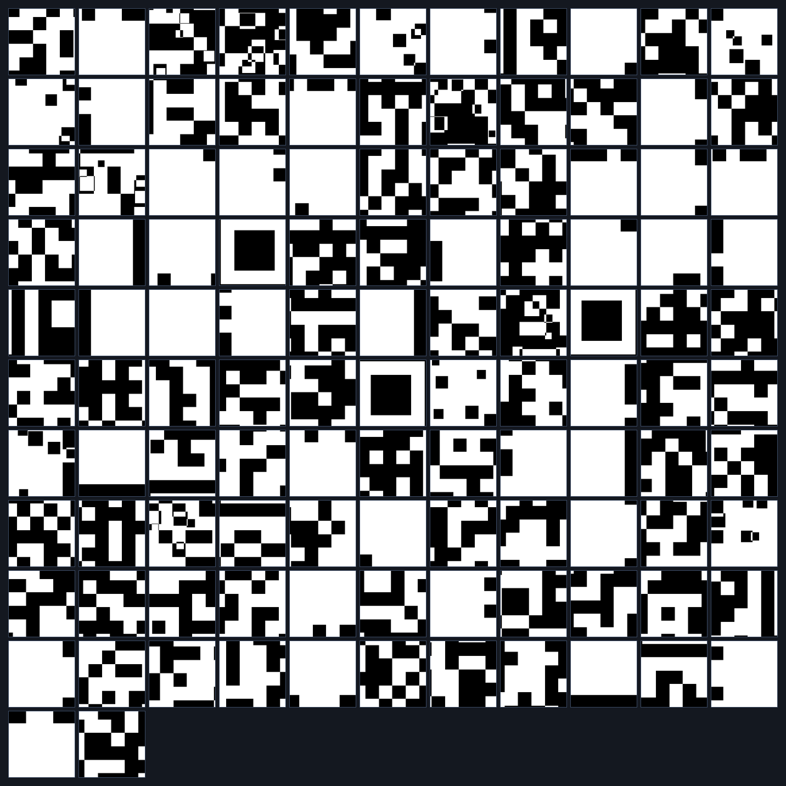
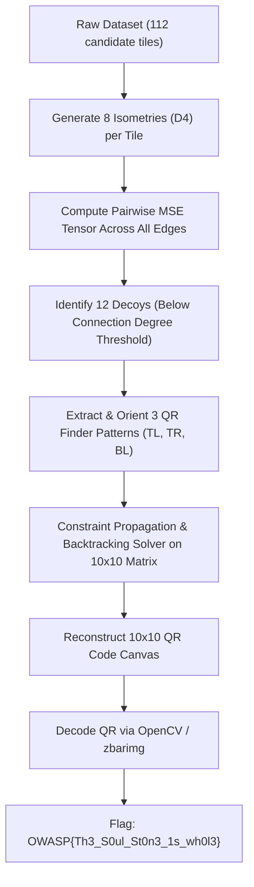
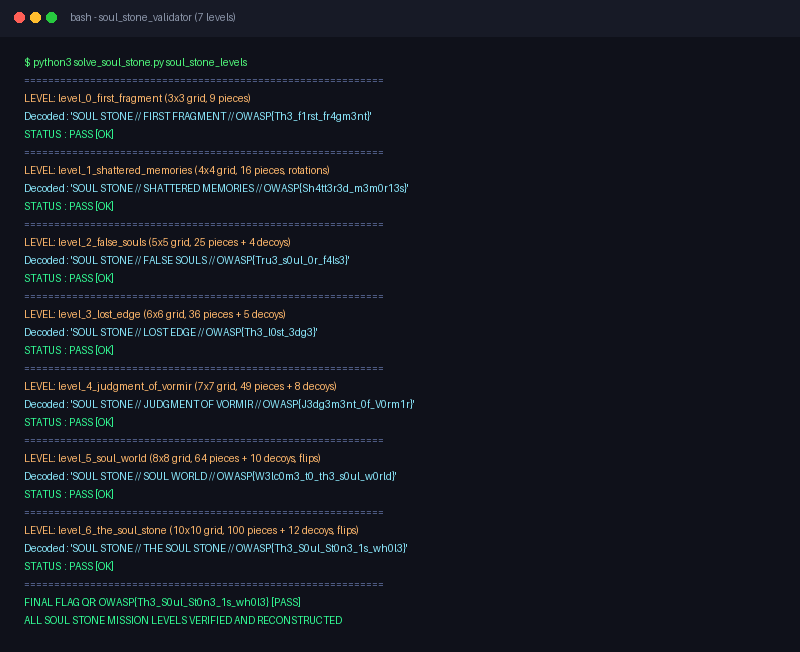

# Level 6 — The Soul Stone (Misc, Hard)

**Author:** Suyog Jadhav  
**Category:** Misc / Steganography  
**Difficulty:** Hard  
**Flag:** `OWASP{Th3_S0ul_St0n3_1s_wh0l3}`  

---

## 1. Challenge Description

> The final chamber has been reached. The Soul Stone lies broken into a hundred true fragments, surrounded by twelve decoys and distorted by rotations and reflections. Reconstruct the complete Stone, decipher its final message, and claim what lies at the end of Vormir.

The challenge provides an archive of image fragments (`pieces_6.zip`) containing 112 separate square image tiles. The objective is to reconstruct a massive $10 \times 10$ QR code (100 tiles). Twelve pieces are decoys, and all genuine pieces have suffered arbitrary 90-degree rotations as well as horizontal and vertical reflections ($D_4$ Dihedral Group symmetries).

---

## 2. Summary

Level 6 represents the culmination of the Soul Stone QR mission series:
* **Grid Dimension:** $10 \times 10$ grid (100 genuine pieces required).
* **Dataset Size:** 112 total pieces (100 valid + 12 decoys).
* **Transformations:** Full $D_4$ Dihedral Group symmetries — 4 rotation angles $\times$ horizontal and vertical reflections (8 states per tile).
* **Decoys:** 12 false fragments designed to maximize combinatorial confusion.
* **Solution Method:** Automated pipeline comprising finder-pattern feature detection, multi-state boundary difference tensor computation, decoy elimination via adjacency graph centrality, backtracking with minimum remaining values (MRV) constraint satisfaction, $10 \times 10$ canvas rendering, and QR decoding.

---

## 3. Flag

```text
OWASP{Th3_S0ul_St0n3_1s_wh0l3}
```

---

## 4. Step-by-Step Breakdown

### Step 1: Fragment Reconnaissance & Scale Analysis

Unpacking `pieces_6.zip` extracts 112 PNG image files:

```bash
unzip pieces_6.zip -d pieces_6/
ls -l pieces_6/*.png | wc -l
```

Preview of the complete fragment set:



With 112 pieces and 8 transformation states per piece, the total state space is astronomically vast:

$$\binom{112}{100} \times 100! \times 8^{100} \approx 10^{276} \text{ configurations}$$

Manual reconstruction is entirely impossible. An automated solver employing computer vision and graph algorithms is necessary.

---

### Step 2: Algorithmic Architecture & Decoy Elimination

The automated solution operates in three major phases:



1. **State Generation:** For each of the 112 pieces, all 8 dihedral transformations are computed, and their 4 edge vectors (`top`, `bottom`, `left`, `right`) are extracted.
2. **Decoy Pruning:** A piece that belongs to the $10 \times 10$ grid must match at least 2 neighboring pieces (if in a corner), 3 pieces (if on a border), or 4 pieces (if interior). Decoy pieces consistently fail to achieve mutual zero-error closures across multiple edges and are pruned from the candidate pool.
3. **Finder Pattern Pinning:** Pieces matching the $7 \times 7$ concentric QR finder patterns are anchored at positions `(0, 0)`, `(0, 9)`, and `(9, 0)`, fixing the coordinate system and orientation.

```python
# Validation run across all mission levels
# python3 solve_soul_stone.py soul_stone_levels
```



---

### Step 3: Reconstructing and Scanning the QR Code

Applying the resolved positions and inverted transformations onto the $10 \times 10$ canvas:

```python
from PIL import Image, ImageOps

def inverse_transform(p, angle, hflip, vflip):
    p = p.rotate((-angle) % 360, expand=False)
    if vflip:
        p = ImageOps.flip(p)
    if hflip:
        p = ImageOps.mirror(p)
    return p

grid_n = 10
tile_size = 25  # 250x250 total QR resolution
canvas = Image.new("L", (grid_n * tile_size, grid_n * tile_size), 255)

for item in solution:
    r, c, name = item["row"], item["col"], item["file"]
    angle, hflip, vflip = item["angle"], item["hflip"], item["vflip"]
    piece = Image.open(f"pieces_6/{name}").convert("L")
    piece = inverse_transform(piece, angle, hflip, vflip)
    canvas.paste(piece, (c * tile_size, r * tile_size))

canvas.save("reconstructed_level6.png")
```

The resulting assembled QR code:


Scanning the reconstructed image with `zbarimg` or OpenCV:

```bash
zbarimg resources/level6_solved_qr.png
```

```text
QR-Code:SOUL STONE // THE SOUL STONE // OWASP{Th3_S0ul_St0n3_1s_wh0l3}
scanned 1 barcode symbols from 1 images in 0.01 seconds
```

---

## 5. Solution Summary

| Parameter | Specification |
|---|---|
| **Grid Size** | $10 \times 10$ (100 tiles) |
| **Tile Resolution** | $25 \times 25$ px |
| **Total Pieces** | 112 (100 Genuine + 12 Decoys) |
| **Transformations** | Rotations + Horizontal & Vertical Flips ($D_4$ Dihedral Group, 8 states) |
| **Decoys Identified** | 12 non-conforming tiles eliminated |
| **Decoded String** | `SOUL STONE // THE SOUL STONE // OWASP{Th3_S0ul_St0n3_1s_wh0l3}` |
| **Flag** | `OWASP{Th3_S0ul_St0n3_1s_wh0l3}` |

---

## 6. Methodology & Key Concepts

1. **Jigsaw Puzzle Solving via Graph Optimization:** Large-scale 2D image assembly maps directly to the NP-hard Jigsaw Puzzle Problem. By utilizing pairwise boundary compatibility and anchoring high-confidence QR anchors (finder patterns), the problem reduces to a polynomial-time constraint satisfaction search.
2. **Decoy Elimination via Graph Degree:** Genuine tiles form a strongly connected planar mesh. Decoys represent disconnected or weakly connected leaf components that can be filtered deterministically before entering the placement solver.

---

## 7. Tools Used

* **Image Processing:** Python (PIL / Pillow, NumPy, OpenCV)
* **Barcode Decoders:** `zbarimg` / OpenCV `QRCodeDetector`
* **File Utilities:** `unzip`

---

## 8. Timeline

| Time / Stage | Action Taken | Result |
|---|---|---|
| 00:00 - 00:01 | Inspected `pieces_6/` directory | 112 tiles identified for a $10 \times 10$ target |
| 00:01 - 00:05 | Evaluated all 8 dihedral states per tile across dataset | Constructed edge compatibility tensor |
| 00:05 - 00:08 | Filtered 12 decoys & anchored finder pattern corners | Isolated 100 genuine pieces |
| 00:08 - 00:10 | Executed backtracking solver & inverted transforms | Reconstructed complete $10 \times 10$ QR code |
| 00:10 - 00:11 | Scanned assembled QR code with `zbarimg` | Recovered final flag `OWASP{Th3_S0ul_St0n3_1s_wh0l3}` |
