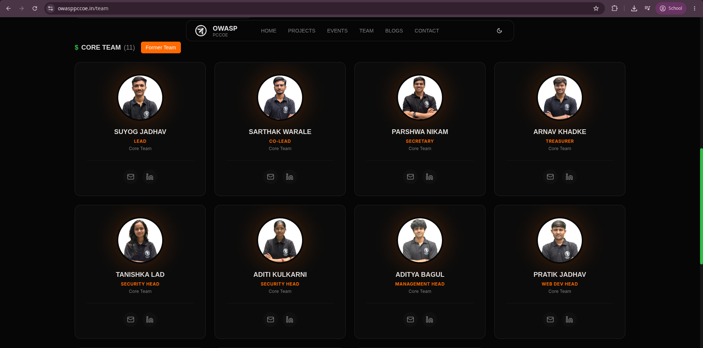
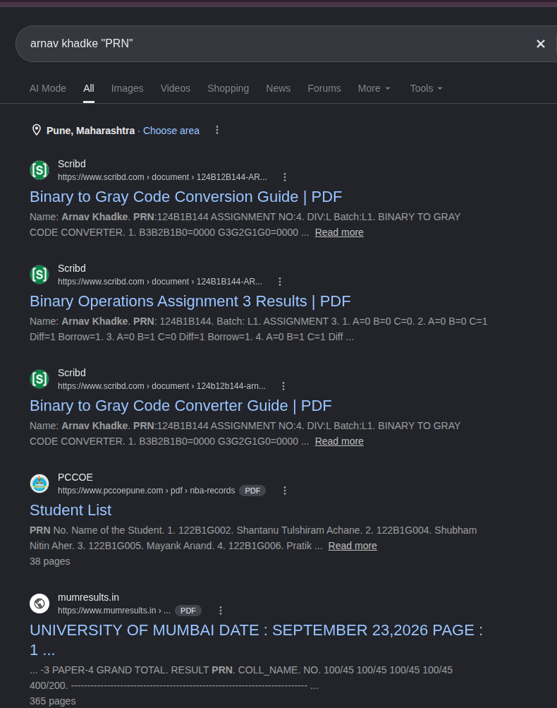

# Stalker 0 (OSINT, Easy)

**Author:** Suyog Jadhav  
**Category:** OSINT  
**Difficulty:** Easy

## Challenge Description

> Let's see your OSINT skills. Check the image and get the **firstname**, **lastname**, **PRN**, and **role** of the given person.  
> Flag format: `OWASP{firstname_lastname_prn_role}` — all in **CAPS**

**Given:** A photograph of a person.

## Summary

The challenge provides a photo of an individual and asks you to identify their full name, PRN (Permanent Registration Number), and their role in the organization. The solution involves cross-referencing the given image against the OWASP PCCOE chapter's official website to identify the person and their role, followed by a targeted Google search to uncover their PRN from publicly indexed documents on Scribd.

## Flag

```
OWASP{ARNAV_KHADKE_124B1B144_TREASURER}
```

---

## Step 1 — Analyze the Given Image

The challenge provides the following image of an individual:


At first glance, this appears to be a simple portrait photo with no obvious embedded metadata hints. The key here is to **recognize the person** — or find a way to match this face to a public identity tied to OWASP PCCOE.

## Step 2 — Identify the Person via the OWASP PCCOE Team Page

Since the challenge is hosted by **OWASP PCCOE**, a logical first step is to browse their official website's team page:

```
https://owasppccoe.in/team
```

This page lists all core team members along with their profile photos, names, and roles. By visually comparing the challenge image against the team photos, the individual is identified as **Arnav Khadke**, holding the role of **Treasurer**.



This gives us three of the four required fields:

- **First Name:** ARNAV
- **Last Name:** KHADKE
- **Role:** TREASURER

## Step 3 — Find the PRN via Google Dorking

The remaining unknown is the **PRN (Permanent Registration Number)**. PRNs are assigned to students by their university and are not typically listed on social media or official club pages. However, they can surface in publicly shared academic documents.

Using a targeted Google search with the person's name and the keyword `PRN` in quotes:

```
arnav khadke "PRN"
```

The top results from **Scribd** immediately surface documents that include the name **Arnav Khadke** alongside the PRN `124B1B144` — visible in assignment submissions indexed from the PCCOE domain.



The Scribd documents are academic assignment submissions that contain a header line such as:

```
Name: Arnav Khadke. PRN: 124B1B144 ...
```

This gives us the final piece:
- **PRN:** 124B1B144

## Solution Summary

| Field | Value |
|---|---|
| First Name | ARNAV |
| Last Name | KHADKE |
| PRN | 124B1B144 |
| Role | TREASURER |

Combining these in the required flag format:

```
OWASP{ARNAV_KHADKE_124B1B144_TREASURER}
```

## OSINT Methodology

1. **Start with what you know** — the challenge is from OWASP PCCOE, so their own website is the most relevant starting point.
2. **Visual matching** — compare the given image to team/staff pages of the relevant organization.
3. **Google dorking for semi-public data** — PRNs, roll numbers, and similar identifiers often appear in academic PDFs uploaded to sites like Scribd or SlideShare. Searching `"name" "PRN"` is a reliable dork for Indian college students.

## Tools Used

- Browser — manual navigation to `owasppccoe.in/team`
- Google Search — query: `arnav khadke "PRN"`
- Scribd — publicly indexed academic documents revealing the PRN

## Timeline

| Step | Action | Result |
|---|---|---|
| 1 | Viewed the challenge image | Person identified as unknown individual |
| 2 | Browsed `owasppccoe.in/team` | Matched face → **Arnav Khadke**, role: **Treasurer** |
| 3 | Google dork: `arnav khadke "PRN"` | Scribd results revealed PRN **124B1B144** |
| 4 | Assembled flag | `OWASP{ARNAV_KHADKE_124B1B144_TREASURER}` |
