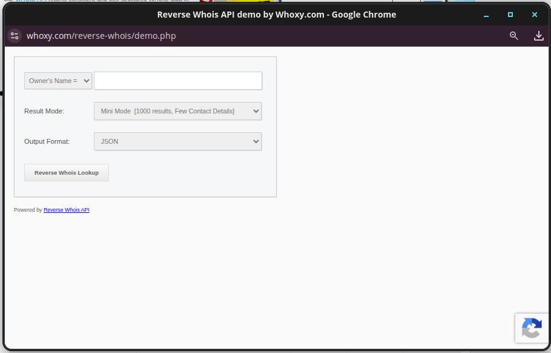
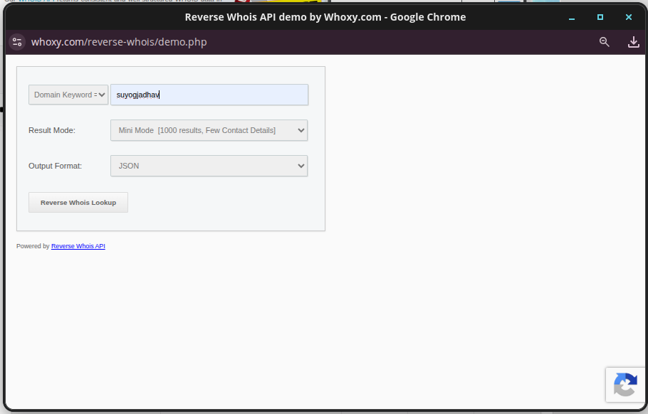
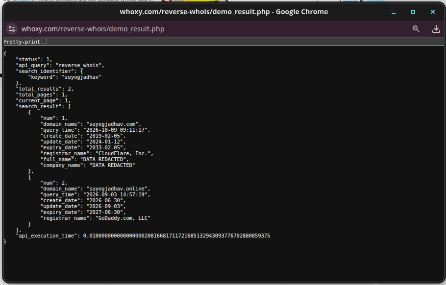
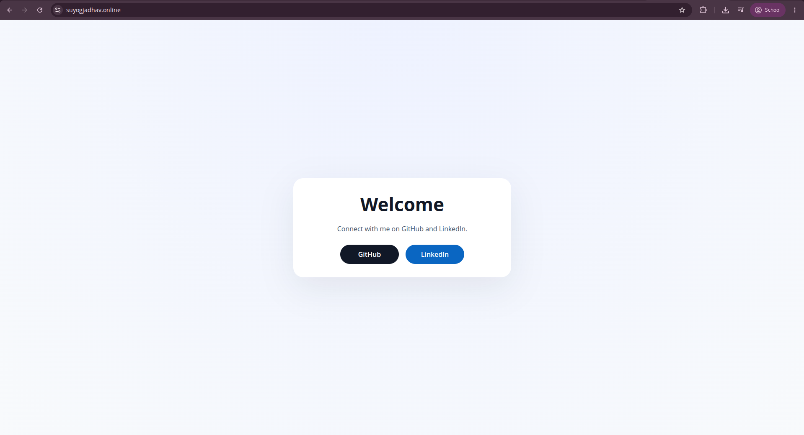
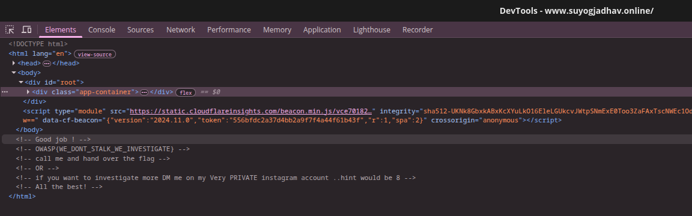

# Stalker 1 (OSINT, Medium)

**Author:** Suyog Jadhav  
**Category:** OSINT  
**Difficulty:** Medium

## Challenge Description

> Author has purchased a domain a few months ago, can you find the flag?

**Hint/Format:** `OWASP{...}`

## Summary

The challenge requires tracking down a domain recently registered by the author (Suyog Jadhav). Using a Reverse WHOIS lookup service (Whoxy) with the author's name as a keyword reveals two domains: `suyogjadhav.com` (created back in 2019) and `suyogjadhav.online` (created recently on 2026-06-30). Inspecting the source code / DOM of `suyogjadhav.online` reveals the hidden flag commented out at the bottom of the HTML.

## Flag

```
OWASP{WE_DONT_STALK_WE_INVESTIGATE}
```

---

## Step 1 — Reverse WHOIS Lookup

Given the clue that the author recently purchased a domain, we perform a **Reverse WHOIS** search to discover domains associated with the author's name (`suyogjadhav`).

Navigating to the Whoxy Reverse Whois API demo tool:

```
https://www.whoxy.com/reverse-whois/demo.php
```



We search using the **Domain Keyword** filter set to `suyogjadhav`:



## Step 2 — Analyze the WHOIS Records

Executing the search returns two registered domains in JSON format:

```json
{
    "status": 1,
    "api_query": "reverse_whois",
    "search_identifier": {
        "keyword": "suyogjadhav"
    },
    "total_results": 2,
    "total_pages": 1,
    "current_page": 1,
    "search_result": [
        {
            "num": 1,
            "domain_name": "suyogjadhav.com",
            "query_time": "2026-10-09 09:11:17",
            "create_date": "2019-02-05",
            "update_date": "2024-01-12",
            "expiry_date": "2033-02-05",
            "registrar_name": "CloudFlare, Inc.",
            "full_name": "DATA REDACTED",
            "company_name": "DATA REDACTED"
        },
        {
            "num": 2,
            "domain_name": "suyogjadhav.online",
            "query_time": "2026-09-03 14:57:19",
            "create_date": "2026-06-30",
            "update_date": "2026-09-03",
            "expiry_date": "2027-06-30",
            "registrar_name": "GoDaddy.com, LLC"
        }
    ],
    "api_execution_time": 0.01
}
```



Looking at the creation dates:
- `suyogjadhav.com` was registered on **2019-02-05** (older domain).
- `suyogjadhav.online` was registered on **2026-06-30** (registered just a few months prior, matching the challenge prompt).

This confirms the target domain is `suyogjadhav.online`.

## Step 3 — Inspect the Target Website

Visiting `https://suyogjadhav.online` in the browser displays a minimal landing page:



On initial view, only "Welcome" and links to GitHub and LinkedIn are visible on the page.

## Step 4 — Inspect Elements (View Source)

Opening DevTools (`F12` or `Ctrl + Shift + I`) and checking the DOM / Elements tab reveals HTML comments right after `</body>`:

```html
<!-- Good job ! -->
<!-- OWASP{WE_DONT_STALK_WE_INVESTIGATE} -->
<!-- call me and hand over the flag -->
<!-- OR -->
<!-- if you want to investigate more DM me on my Very PRIVATE instagram account ..hint would be 8 -->
<!-- All the best! -->
```



The comment directly exposes the flag!

## Solution Summary

| Field | Value |
|---|---|
| Target Individual | Suyog Jadhav |
| Tool Used | Whoxy Reverse WHOIS |
| Target Domain | `suyogjadhav.online` |
| Registration Date | 2026-06-30 |
| Flag Location | HTML comment below `</body>` |

## OSINT Methodology

1. **Pivot on Names/Keywords:** When hunting for digital footprints, domain registrar databases and Reverse WHOIS lookups are powerful tools to uncover websites owned or managed by an entity.
2. **Filter by Timestamps:** When clues mention recent activity (e.g., "purchased a few months ago"), correlate the `create_date` from WHOIS metadata to isolate the correct target.
3. **Always Check Source Code:** A visually plain web page often contains hidden comments, developer notes, or endpoints left in the HTML markup.

## Tools Used

- **Whoxy (Reverse WHOIS API / Demo):** Discovered registered domains associated with the keyword `suyogjadhav`.
- **Web Browser (Chrome DevTools):** Inspected DOM elements to reveal the comment containing the flag.

## Timeline

| Step | Action | Result |
|---|---|---|
| 1 | Searched author's name on Whoxy Reverse WHOIS | Discovered `suyogjadhav.com` and `suyogjadhav.online` |
| 2 | Checked `create_date` metadata | Identified `suyogjadhav.online` (created 2026-06-30) as recent |
| 3 | Navigated to `suyogjadhav.online` | Minimal welcome page displayed |
| 4 | Opened DevTools (Inspect Element) | Found flag inside HTML comments below `</body>` |