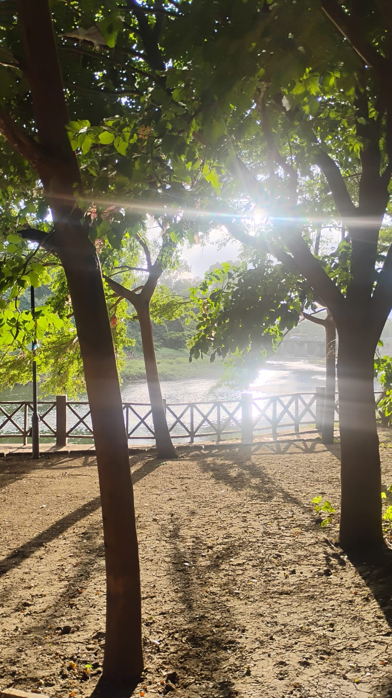
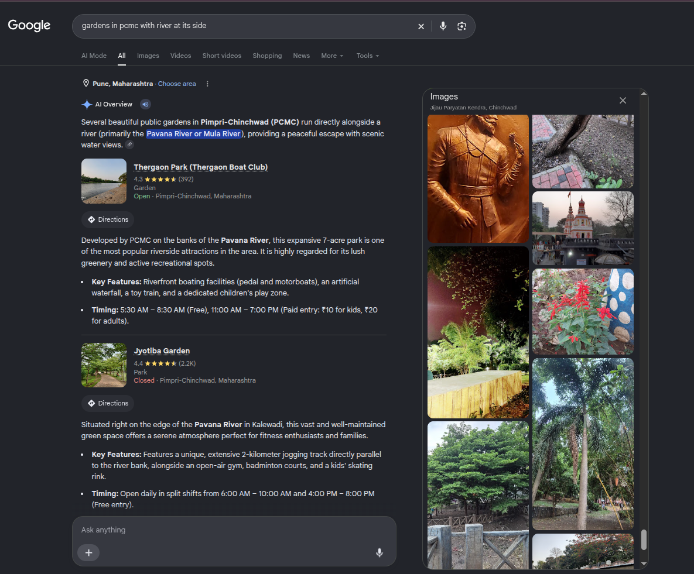
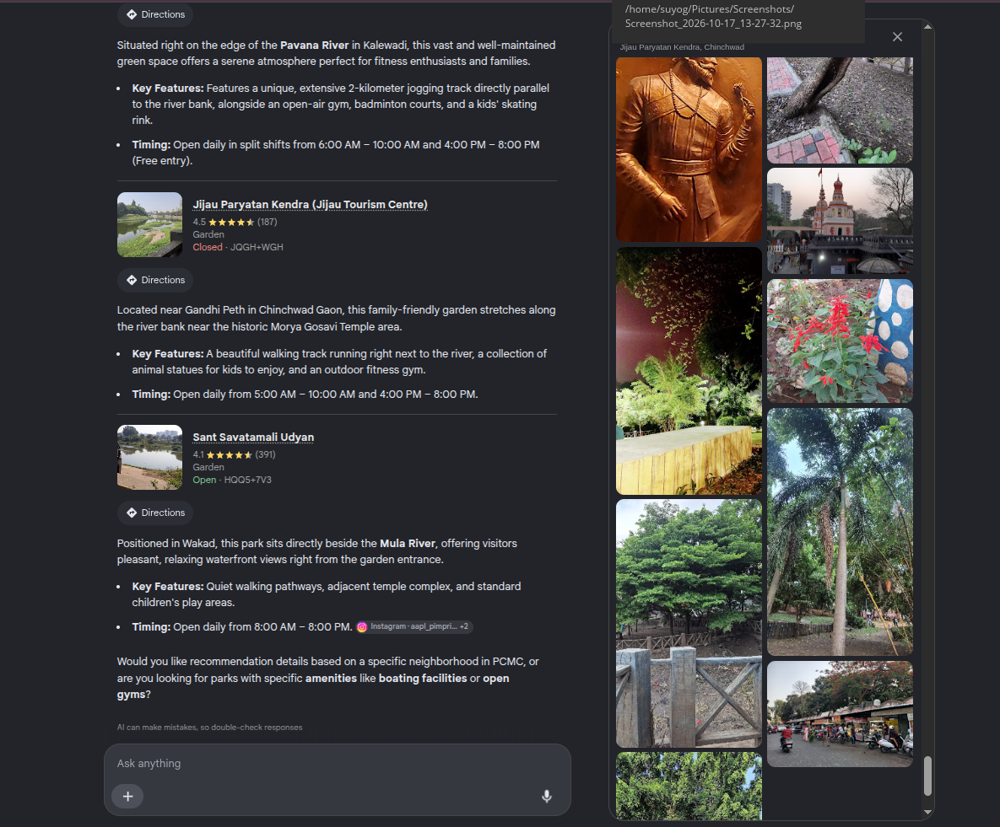
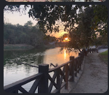
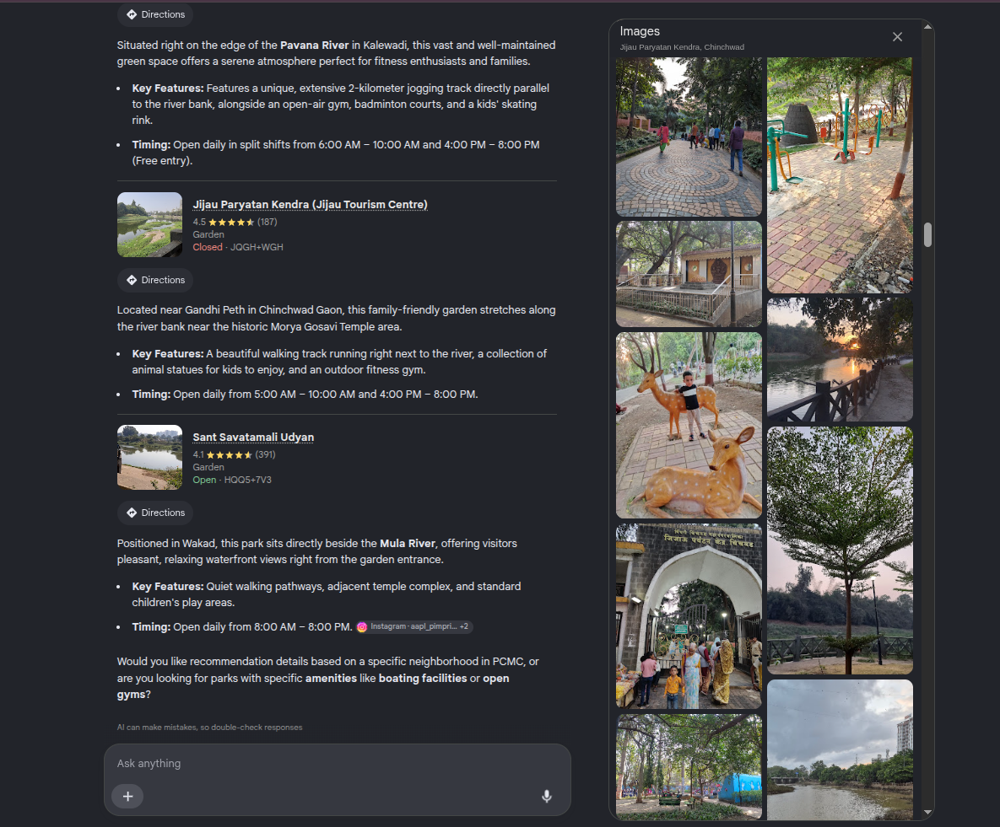

# The Place (OSINT, Medium)

**Author:** Suyog Jadhav  
**Category:** OSINT  
**Difficulty:** Medium

## Challenge Description

> Can you find the exact name of the place on Google Maps?  
> Flag format: `OWASP{xyz_pqr_abc}` — all lowercase

**Given:** A photograph taken inside a park looking out toward a river.



## Summary

The challenge presents a scenic photograph taken through trees inside a riverside garden, showing an open dirt path leading to a wooden criss-cross railing along a river. By correlating the visual features (riverside park/walking path) with author-centric OSINT (knowing the author resides in the PCMC / Pimpri-Chinchwad region of Pune), we query for riverside gardens in PCMC. Reviewing photo contributions for the short-listed gardens on Google Maps leads to matching photos of the exact wooden fence and riverbank under **Jijau Paryatan Kendra, Chinchwad**.

## Flag

```
OWASP{jijau_paryatan_kendra_chinchwad}
```

---

## Step 1 — Analyze the Challenge Image

Inspecting the provided image (`the_place.jpeg`) reveals several key visual indicators:

1. **Park Environment:** Sunbeams filtering through trees onto an open dirt path.
2. **Riverside Setting:** A river directly in front, with opposite banks and a bridge structure in the distance.
3. **Distinctive Fencing:** A dark wooden fence with repetitive cross-brace (`X`) railings running along the water's edge.
4. **Local Context / Geolocation Clue:** From author profiling, Suyog Jadhav is based in the **PCMC (Pimpri-Chinchwad, Pune)** area, narrowing the search scope to PCMC riverside gardens.

## Step 2 — Targeted Search for Riverside Gardens in PCMC

Riverside gardens are relatively few and specific in any municipal corporation. In PCMC, the primary waterways running through the city are the **Pavana River** and the **Mula River**.

Using this knowledge, we perform a focused search on Google / Google Maps:

```
gardens in pcmc with river at its side
```



Google compiles candidate locations along the Pavana and Mula rivers:

1. **Thergaon Park (Thergaon Boat Club)** — Pavana River
2. **Jyotiba Garden** — Kalewadi, Pavana River
3. **Jijau Paryatan Kendra (Jijau Tourism Centre)** — Chinchwad Gaon, Pavana River
4. **Sant Savatamali Udyan** — Wakad, Mula River



## Step 3 — Cross-Referencing Candidate Photo Galleries

Because reverse image search engines (like Google Lens) struggle with natural park images, the most reliable method is to manually inspect the **user-contributed photo galleries** on Google Maps for each candidate location.

Navigating to **Jijau Paryatan Kendra (Jijau Tourism Centre)** in Chinchwad Gaon (near Gandhi Peth and the historic Morya Gosavi Temple area):

```
Jijau Paryatan Kendra, Chinchwad
```

Browsing the uploaded photos for this location reveals images taken along the exact same path and riverbank:

- The same dark wooden cross-brace (`X`) barrier railings bordering the Pavana river.
- The matching trees, paved walking track, and riverbank perspective:



Viewing the full photo gallery for the location confirms the match:



## Step 4 — Formulate the Flag

The location name on Google Maps is:

```
Jijau Paryatan Kendra, Chinchwad
```

Formatting the name according to the challenge requirements (lowercase, separated by underscores):

```
OWASP{jijau_paryatan_kendra_chinchwad}
```

## Solution Summary

| Field | Value |
|---|---|
| Region / City | PCMC (Pimpri-Chinchwad, Maharashtra) |
| River | Pavana River |
| Search Query | `gardens in pcmc with river at its side` |
| Location Name | Jijau Paryatan Kendra, Chinchwad |
| Flag | `OWASP{jijau_paryatan_kendra_chinchwad}` |

## OSINT Methodology

1. **Geographic Scoping via Author Profiling:** When a challenge image lacks obvious signage or unique global landmarks, use the author's known location (in this case, PCMC / Pune) to drastically constrain the search radius.
2. **Feature-Based Querying:** Break the environment into core geographical components (`park` / `garden` + `river` + `city/area`) rather than searching blindly.
3. **Manual Photo Gallery Verification:** User-submitted photos on Google Maps often contain the exact perspective or uploaded image, even when automated visual search algorithms fail.

## Tools Used

- **Google Search / Google Maps:** Querying riverside parks within the PCMC municipality and verifying user-contributed photos.

## Timeline

| Step | Action | Result |
|---|---|---|
| 1 | Analyzed challenge image features | Identified park trail, riverside, criss-cross wooden fencing |
| 2 | Applied PCMC regional filter | Queried `gardens in pcmc with river at its side` |
| 3 | Filtered candidate gardens | Identified 4 parks along Pavana and Mula rivers |
| 4 | Inspected photo gallery of Jijau Paryatan Kendra | Found exact matching photo in Google Maps images |
| 5 | Converted name to flag format | `OWASP{jijau_paryatan_kendra_chinchwad}` |