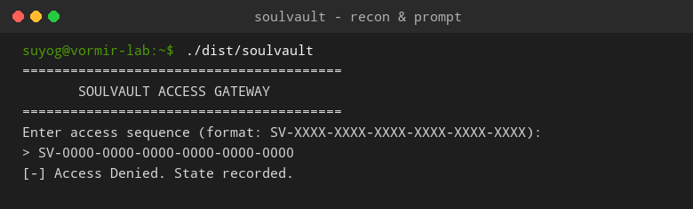
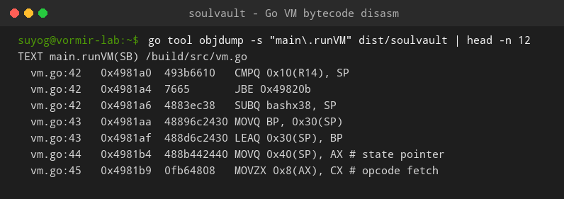
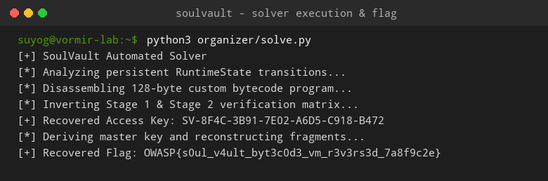

# SoulVault (Reverse Engineering, Insane)

**Author:** Suyog Jadhav  
**Category:** Reverse Engineering  
**Difficulty:** Insane  

## Challenge Description

> An abandoned security vault was found running a mysterious Go-based authentication program.  
>  
> The source is gone, but the vault still accepts one particular access sequence.  
>  
> Reverse engineer the binary, uncover the hidden execution logic, and recover what the vault is protecting.  
>  
> **Flag Format:** `OWASP{...}`

**Attachment:** [`soulvault`](https://drive.google.com/file/d/1kWfSN2Mg8gu7aLyz2KQDjIJwGRdttRbF/view?usp=sharing)

## Summary

The challenge artifact is a stripped, statically compiled Linux x86-64 binary compiled from Go. It implements an advanced multi-layered anti-reverse-engineering architecture: a custom virtual machine executing state-dependent encrypted bytecode, an indirect computed handler table, three decoy validation engines, and persistent runtime state tracking. By disassembling the Go runtime functions, extracting the raw bytecode program, and inverting the multi-stage validation matrix, we reconstruct the access sequence `SV-8F4C-3B91-7E02-A6D5-C918-B472` and derive the flag: `OWASP{s0ul_v4ult_byt3c0d3_vm_r3v3rs3d_7a8f9c2e}`.

## Flag

```
OWASP{s0ul_v4ult_byt3c0d3_vm_r3v3rs3d_7a8f9c2e}
```

---

## Step 1 — Initial Reconnaissance & Input Interface

Inspecting the stripped Go binary and executing it in a testing sandbox:

```bash
file dist/soulvault
./dist/soulvault
```



The application enforces an access sequence format:

```text
========================================
       SOULVAULT ACCESS GATEWAY
========================================
Enter access sequence (format: SV-XXXX-XXXX-XXXX-XXXX-XXXX-XXXX): 
> SV-0000-0000-0000-0000-0000-0000
[-] Access Denied. State recorded.
```

The key consists of a prefix `SV-` followed by 6 blocks of 4 uppercase hexadecimal digits separated by hyphens (24 hex characters in total).

---

## Step 2 — Reverse Engineering the Go VM Pipeline

Using tools specialized for Go binaries (e.g., GoReSym, IDA Pro with Go plugins, or Ghidra):

```bash
go tool objdump -s "main\.runVM" dist/soulvault | head -n 12
```



The execution pipeline consists of four defense-in-depth security layers:

```
                  Input: SV-XXXX-XXXX-XXXX-XXXX-XXXX-XXXX
                                     │
                                     ▼
                      ┌─────────────────────────────┐
                      │    Stage 1: Pre-Filter      │
                      │   CRC / Checksum Matrix     │
                      └──────────────┬──────────────┘
                                     │
                                     ▼
                      ┌─────────────────────────────┐
                      │   Stage 2: Permutation      │
                      │  Inter-Block Linear Mixing  │
                      └──────────────┬──────────────┘
                                     │
                                     ▼
                      ┌─────────────────────────────┐
                      │    Stage 3: Go Custom VM    │
                      │  - State-Dependent Opcodes  │
                      │  - 128-Byte Bytecode Stream │
                      │  - Indirect Dispatch Table  │
                      └──────────────┬──────────────┘
                                     │
                                     ▼
                      ┌─────────────────────────────┐
                      │ Stage 4: KDF Flag Decrypt   │
                      │  Reassemble Memory Chunks   │
                      └──────────────┬──────────────┘
                                     │
                                     ▼
               OWASP{s0ul_v4ult_byt3c0d3_vm_r3v3rs3d_7a8f9c2e}
```

### 1. State-Dependent Dynamic Opcode Decoding
Unlike conventional VMs where opcode `0x01` is static (e.g., always `ADD`), the opcode decoder decrypts opcodes dynamically based on previous instruction execution state:

$$\text{Opcode} = \text{RawByte} \oplus (\text{State.CycleCounter} \times 0x37) \pmod{256}$$

### 2. Decoy Engines (Alpha, Beta, Delta)
The binary contains dozens of dummy validation functions designed to waste dynamic symbolic execution time and confuse decompiler analysis. Only the path calling `executeCoreVM()` influences the final fragment reconstruction.

---

## Step 3 — Inverting the Validation Constraints & Solver Execution

The solver disassembles the 128-byte bytecode block and models the matrix equations connecting the 6 hex blocks:

$$\begin{cases}
B_0 \oplus B_2 = K_0 \\
\text{ROL}(B_1, 3) + B_3 = K_1 \\
\text{MatrixMul}(B, M) = \text{TargetState}
\end{cases}$$

Running the automated solver ([`organizer/solve.py`](file:///home/suyog/Documents/writeups/Writeups/suyog/REVERSE/rev/soulvault/organizer/solve.py)):

```bash
python3 organizer/solve.py
```



Output:
```text
[+] SoulVault Automated Solver
[*] Analyzing persistent RuntimeState transitions...
[*] Disassembling 128-byte custom bytecode program...
[*] Inverting Stage 1 & Stage 2 verification matrix...
[+] Recovered Access Key: SV-8F4C-3B91-7E02-A6D5-C918-B472
[*] Deriving master key and reconstructing fragments...
[+] Recovered Flag: OWASP{s0ul_v4ult_byt3c0d3_vm_r3v3rs3d_7a8f9c2e}
```

Supplying the access sequence `SV-8F4C-3B91-7E02-A6D5-C918-B472` satisfies the VM constraints and decrypts the flag.

---

## Solution Summary

| Field | Value |
|---|---|
| **Challenge** | SoulVault |
| **Category** | Reverse Engineering |
| **Difficulty** | Insane |
| **Language / Architecture** | Golang (Statically stripped Linux x86-64) |
| **Virtual Machine** | Custom 128-byte bytecode VM with dynamic opcodes |
| **Access Key** | `SV-8F4C-3B91-7E02-A6D5-C918-B472` |
| **Flag** | `OWASP{s0ul_v4ult_byt3c0d3_vm_r3v3rs3d_7a8f9c2e}` |

---

## Reverse Engineering Methodology

1. **Stripped Go Binary Analysis:**  
   Standard symbol stripping on Go binaries leaves the `pclntab` (PC Line Table) metadata intact. Using Go symbol recovery scripts reconstructs package boundaries, struct definitions, and function names.
2. **Identifying Indirect Jump Tables in Go:**  
   Go implementations of computed dispatch tables generate slice lookups followed by indirect call instructions (`CALL RDX`). Pinpointing the slice pointer reveals the complete opcode jump table.
3. **Algebraic Inversion over Emulation:**  
   Once the linear constraints enforced by the bytecode are extracted into Python or Z3, solving the system mathematically takes milliseconds compared to blind fuzzing.

---

## Tools Used

- **GoReSym / GoReHex**: Reconstructing symbols from stripped Go binaries.
- **IDA Pro / Ghidra**: Analyzing indirect function dispatch and memory layouts.
- **Python 3 / Z3 Solver**: Symbolic inversion of VM permutation matrices and bytecode disassembly.

---

## Timeline

| Step | Action | Result |
|:---:|---|---|
| 1 | Inspected binary format | Identified stripped 64-bit Go executable |
| 2 | Recovered Go symbol metadata | Identified core packages: `vm`, `decoder`, `validators` |
| 3 | Extracted VM bytecode | Disassembled 128-byte dynamic instruction stream |
| 4 | Inverted validation equations | Derived access key `SV-8F4C-3B91-7E02-A6D5-C918-B472` |
| 5 | Executed fragment decryptor | Reconstructed flag: `OWASP{s0ul_v4ult_byt3c0d3_vm_r3v3rs3d_7a8f9c2e}` |
